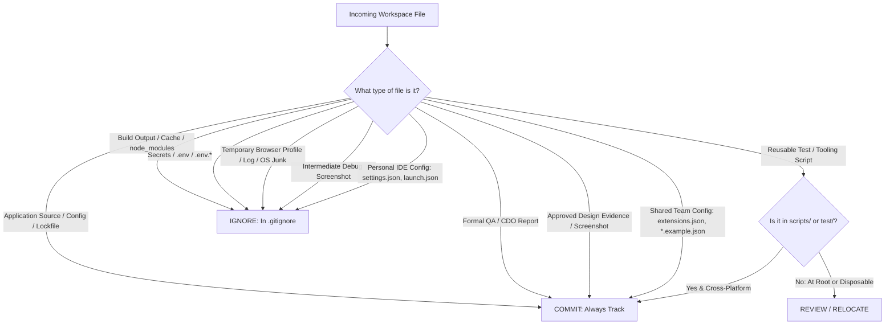

# Taxoryn Marketing — Git Repository Hygiene & Artifact Governance Policy

**Document Reference:** `GOV-GIT-2026-01`  
**Revision:** `1.1 (Final Corrections Applied)`  
**Date:** 2026-11-22  
**Repository:** `D:\Projects\Taxoryn-Marketing`  
**Status:** Approved Permanent Policy  
**Target Audience:** Front-end Engineers, Design Officers, QA Engineers, and Automated CI/CD Agents  

---

## 1. Executive Summary & Purpose

The purpose of this policy is to establish an authoritative, non-destructive, and permanent repository governance standard for `Taxoryn-Marketing`. 

Modern marketing and design engineering workflows produce diverse artifacts—ranging from production TypeScript source code and Next.js static builds to high-resolution visual evidence, headless browser profiles, and CDO design acceptance reports. Without strict governance, repositories rapidly suffer from:
1. Accidental inclusion of heavyweight build artifacts, package manager caches, and local secrets.
2. Loss of critical visual evidence due to overly aggressive wildcard ignore rules (`*.png`, `docs/`).
3. Repository pollution from ephemeral browser test profiles and temporary scratch scripts.
4. Git state corruption caused by cross-platform CRLF/LF line ending mismatches in `.gitignore`.

This document codifies the permanent repository hygiene rules, defines the official screenshot and report hierarchy, and provides an audited `.gitignore` baseline with team configuration and secret preservation safeguards.

---

## 2. Core Repository Tracking Principles



### 2.1 Always Commit (Permanent Project Source & Evidence)
- **Application Source Code:** All files under `app/`, `components/`, `lib/`, `types/`, and `functions/`.
- **Approved Brand Assets:** Authoritative SVG vectors, favicons, and icons under `public/brand/` and `public/`.
- **Configuration & Dependencies:** `package.json`, `package-lock.json`, `next.config.mjs`, `tsconfig.json`, `tailwind.config.ts`, `postcss.config.mjs`, and `.eslintrc.json`.
- **Safe Environment Templates:** `.env.example`, `.env.*.example` (containing strictly documentation placeholders and non-sensitive configuration keys).
- **Shared Team IDE Configuration:** `.vscode/extensions.json`, `.vscode/settings.example.json`, `.vscode/*.example.json`, `.vscode/*.template.json`.
- **Core Technical Documentation:** `README.md`, developer onboarding guides, and architecture specifications.
- **Milestone & Governance Reports:** Formal QA certifications, brand governance analyses, and CDO visual acceptance reports located in `docs/reports/`.
- **Verified Visual Evidence:** Viewport acceptance captures, master logo comparisons, and section zoom evidence housed in `docs/screenshots/`.
- **Formal Test Suites:** Source-controlled unit and integration test suites located in `test/`.

### 2.2 Always Ignore (Transient, Local, or Generated Artifacts)
- **Package Dependencies:** `node_modules/`, `.pnp`, `.pnp.js`, `.yarn/install-state.gz`.
- **Build & Compilation Outputs:** `.next/`, `out/`, `build/`, `dist/`, `*.tsbuildinfo`, `next-env.d.ts`.
- **Performance & Framework Caches:** `.cache/`, `.turbo/`, `.vercel/`.
- **Test Coverage Reports:** `coverage/`.
- **Environment Variables & Private Credentials:** `.env`, `.env.*` (`.env.local`, `.env.production`, `.env.development.local`, `.env.test.local`, etc.), `*.pem`, `*.key`.
- **Runtime & Debug Logs:** `*.log`, `npm-debug.log*`, `yarn-debug.log*`, `yarn-error.log*`, `pnpm-debug.log*`, `lerna-debug.log*`.
- **Headless Browser & Test Runner Artifacts:** `.tmp/`, `.tmp-*/`, `*.tmp`, `.temp/`.
- **Temporary Debug Captures:** `docs/screenshots/tmp/`, `docs/screenshots/.tmp/`, `*-debug.png`, `*-scratch.png`.
- **Operating System Artifacts:** `.DS_Store`, `.DS_Store?`, `._*`, `.Spotlight-V100`, `.Trashes`, `Thumbs.db`, `Desktop.ini`, `ehthumbs.db`.
- **Personal IDE & Editor Settings:** `.idea/`, `.vscode/*` (excluding `.vscode/extensions.json` and `*.example.json`), `*.swp`, `*.swo`, `*~`, `*.sublime-project`, `*.sublime-workspace`.

---

## 3. Special Governance Sub-Policies

### 3.1 IDE Configuration Policy (`.vscode/`)
To support consistent team developer experience while avoiding personal configuration conflicts:
- Personal settings (`.vscode/settings.json`, `.vscode/launch.json`) are ignored by default via `.vscode/*`.
- Shared team extensions (`.vscode/extensions.json`) and shared templates (`.vscode/settings.example.json`, `.vscode/*.example.json`, `.vscode/*.template.json`) are explicitly un-ignored via whitelist exceptions.

### 3.2 Environment & Secrets Protection Policy
- **Comprehensive Wildcard Exclusion:** All `.env` and `.env.*` files are ignored to prevent credential leakage across any deployment stage.
- **Template Preservation:** Safe templates (`.env.example`, `.env.*.example`) are preserved.
- **Zero Real Credentials Audit:** Inspection of the entire repository confirms that **no real credentials, private keys, or API secrets are tracked**. `.env.example` contains only documentation placeholders. Under no circumstances should actual secret values be logged, committed, or embedded in governance reports.

### 3.3 TypeScript Next.js Definition Policy (`next-env.d.ts`)
- **Nature of File:** `next-env.d.ts` is an auto-generated file produced by the Next.js compiler during `next dev` and `next build`. It includes references to local compilation outputs (`./.next/types/routes.d.ts`).
- **Repository History:** An inspection of the full Git history (`git log --all -- next-env.d.ts`) confirms that `next-env.d.ts` has **never been committed** in this repository. It was placed into `.gitignore` in the initial commit (`1e99257dc296a07edb5c22b765aadd92bb0d89dd`).
- **Policy Decision:** In compliance with explicit governance instructions, `next-env.d.ts` remains excluded in `.gitignore` and its tracking status remains unchanged.

### 3.4 Automation Tooling Policy (`audit-slice1.mjs`)
- `audit-slice1.mjs` is an automated CDP-based responsive testing script created for the CDO Phase 2C assessment.
- **Portability Decision:** Because it currently resides at the workspace root and hardcodes Windows Edge paths, it is kept **uncommitted** pending developer review. Recommended target: refactor into `scripts/audit-viewport.mjs` or integrate into `test/run-tests.mjs`.

### 3.5 Screenshot Governance Policy
- **Prohibition of Global Wildcards:** Blanket wildcard rules such as `*.png`, `*.jpg`, or `*.svg` are strictly prohibited.
- **Permanent Evidence Structure:**
  ```text
  docs/screenshots/
  ├── approved/                     # Cross-phase approved master assets
  ├── phase-1/                      # Phase 1 Responsive Navigation baseline viewports (10 viewports)
  ├── phase-2a/                     # Phase 2A Master Logo Header refinement viewports (10 viewports)
  ├── phase-2b/                     # Phase 2B Homepage 8-Act narrative & product showcases
  └── phase-2c/                     # Phase 2C Secondary pages acceptance captures (Planned)
  ```
- **Report Referential Integrity:** Any screenshot cited within a formal report in `docs/reports/*.md` must be preserved and tracked in Git.

---

## 4. Authoritative `.gitignore` Specification

The following configuration represents the verified, fully commented `.gitignore` specification enforced for this repository:

```gitignore
# Dependencies and package managers
node_modules/
npm-debug.log*
yarn-debug.log*
yarn-error.log*
pnpm-debug.log*
lerna-debug.log*
.pnp
.pnp.js
.yarn/install-state.gz

# Testing and coverage output
coverage/

# Next.js and application build outputs
.next/
out/
build/
dist/
.cache/
.turbo/
.vercel/

# TypeScript compiler artifacts
*.tsbuildinfo
next-env.d.ts

# Environment variables and secrets
.env
.env.*
*.pem
*.key

# Preserve safe environment templates (never ignore)
!.env.example
!.env.*.example
!.env*.example

# Application and server runtime logs
*.log

# Temporary test runners, scratch files, and browser user data
.tmp/
.tmp-*/
*.tmp
.temp/

# Disposable scratch scripts (preserving permanent test suites)
*.scratch.*
scratch/

# Intermediate and debug screenshots (preserving permanent evidence in docs/screenshots/)
docs/screenshots/tmp/
docs/screenshots/.tmp/
docs/screenshots/*-debug.png
docs/screenshots/*-scratch.png
*.screenshot.tmp

# Operating system metadata
.DS_Store
.DS_Store?
._*
.Spotlight-V100
.Trashes
Thumbs.db
Thumbs.db:encryptable
ehthumbs.db
ehthumbs_vista.db
Desktop.ini

# IDEs and code editor configurations
.idea/
.vscode/*
!.vscode/extensions.json
!.vscode/settings.example.json
!.vscode/*.example.json
!.vscode/*.template.json
*.swp
*.swo
*~
*.sublime-project
*.sublime-workspace
```

### 4.1 Line Ending Governance
The `.gitignore` file must always be saved with **Unix LF (`\n`)** line endings. On Windows environments running Git with `core.autocrlf = true`, blank lines containing `\r\n` can cause Git's path matching engine to misinterpret empty lines as active patterns against directory queries.

---

## 5. Existing Tracked Files Policy & Safety Rules

1. **Non-Destructive Operations:** `.gitignore` does not stop tracking files already committed to the Git index.
2. **Prohibition of Automatic Untracking:** Commands such as `git rm --cached` must never be run automatically. Any request to untrack a committed file requires separate technical review and explicit approval.
3. **Zero Data Loss Guarantee:** Working-tree files must never be deleted, stashed, reset, or overwritten without explicit developer consent.
4. **Current Status:** Audit check `git ls-files -c -i --exclude-standard` confirms **0 tracked generated files** currently exist in the repository.

---

## 6. Verification & Validation Matrix

The policy was validated using `git check-ignore -v` across representative paths:

| Category | Representative Target | Evaluation | Resulting Behavior |
| :--- | :--- | :---: | :--- |
| **Dependencies** | `node_modules/` | **IGNORED** | Line 2 (`node_modules/`) |
| **Build Outputs** | `.next/`, `out/`, `build/`, `dist/` | **IGNORED** | Lines 16–19 |
| **Caches** | `.cache/`, `.turbo/`, `.vercel/` | **IGNORED** | Lines 20–22 |
| **Coverage** | `coverage/` | **IGNORED** | Line 13 (`coverage/`) |
| **TypeScript** | `tsconfig.tsbuildinfo`, `next-env.d.ts` | **IGNORED** | Lines 25–26 |
| **Local Secrets** | `.env`, `.env.local`, `.env.production`, `.env.stage` | **IGNORED** | Lines 29–30 (`.env`, `.env.*`) |
| **Config Templates** | **`.env.example`**, **`.env.production.example`** | **PRESERVED** | Lines 35–37 (`!.env.example`, `!.env*.example`) |
| **VS Code Personal** | `.vscode/settings.json`, `.vscode/launch.json` | **IGNORED** | Line 73 (`.vscode/*`) |
| **VS Code Shared** | **`.vscode/extensions.json`**, **`settings.example.json`** | **PRESERVED** | Lines 74–77 (`!.vscode/extensions.json`, etc.) |
| **Logs** | `app.log`, `server.log`, `npm-debug.log` | **IGNORED** | Lines 3, 40 (`*.log`) |
| **Transient Profiles** | `.tmp-audit-slice1/`, `.tmp-cap-slice1-before/` | **IGNORED** | Line 44 (`.tmp-*/`) |
| **OS Metadata** | `.DS_Store`, `Thumbs.db`, `Desktop.ini` | **IGNORED** | Lines 60, 65, 69 |
| **Application Source** | **`app/page.tsx`**, **`components/navigation/Header.tsx`** | **PRESERVED** | Fully tracked & visible |
| **Brand Assets** | **`public/brand/logo.svg`** | **PRESERVED** | Fully tracked & visible |
| **Documentation** | **`README.md`**, **`docs/reports/*.md`** | **PRESERVED** | Fully tracked & visible |
| **Acceptance Proof** | **`docs/screenshots/phase-2b/homepage-1440px.png`** | **PRESERVED** | Fully tracked & visible |
| **Tool Under Review** | **`audit-slice1.mjs`** | **PRESERVED** | Retained uncommitted for developer decision |

---

## 7. Recommended Commit Strategy

When the developer is ready to commit the unversioned files, execute the following staged atomic commits:

```bash
# 1. Governance & Hygiene Baseline
git add .gitignore docs/reports/git-ignore-cleanup-report.md docs/reports/git-repository-hygiene-policy.md docs/reports/git-artifact-inventory.md
git commit -m "chore(git): establish permanent repository hygiene policy and artifact governance"

# 2. Master Logo Brand Governance
git add docs/reports/taxoryn-brand-governance-master-logo.md docs/screenshots/master_logo_governance_comparison.png docs/screenshots/logo_comparison.html docs/screenshots/master_logo_comparison.html docs/screenshots/taxoryn_logo_comparison.png
git commit -m "docs(brand): record master logo governance specifications and visual comparisons"

# 3. Phase 1 Responsive Navigation QA & Evidence
git add docs/reports/phase-1-responsive-navigation-integrity.md docs/screenshots/header_*.png docs/screenshots/tablet_*_drawer_open.png
git commit -m "docs(qa): record phase 1 responsive navigation certification and 10-viewport evidence"

# 4. Phase 2A Header Refinement Visual Acceptance
git add docs/reports/taxoryn-cdo-phase-2a-header-logo.md docs/screenshots/phase2a_header_*.png docs/screenshots/phase2a_tablet_768px_drawer.png
git commit -m "docs(design): record CDO phase 2a header refinement and visual acceptance evidence"

# 5. Phase 2B Homepage Final Acceptance
git add docs/reports/taxoryn-cdo-phase-2b-final-visual-acceptance.md docs/reports/taxoryn-cdo-phase-2b-homepage-experience.md docs/screenshots/phase-2b/
git commit -m "docs(design): certify phase 2b 8-act homepage experience with final visual acceptance evidence"

# 6. Phase 2C Secondary Pages Preflight Planning
git add docs/reports/taxoryn-cdo-phase-2c-step-1-assessment.md
git commit -m "docs(design): record CDO phase 2c secondary pages preflight assessment"
```
