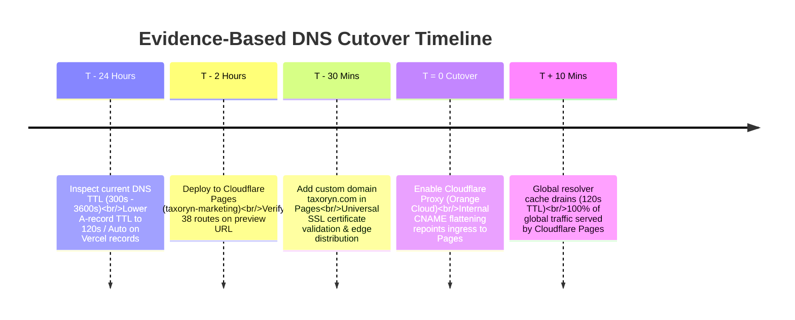

# TAXORYN MARKETING — ARCHITECTURE REVIEW CORRECTIONS & HARDENING
## Workstream: Agent 4 Principal Cloud Architect Revision & Technical Audit

**Document Reference:** `ARCH-CORR-2026-01`  
**Date:** November 22, 2026  
**Author:** Agent 4 (Principal Cloud Architect)  
**Mode:** STRICTLY READ-ONLY ASSESSMENT  
**Subject:** Rigorous Re-Evaluation of Cloudflare Pages + Functions + D1 Architecture

---

## 1. Executive Summary

This report formally addresses and resolves the 10 mandatory technical review points raised in the architecture governance gate.

It replaces preliminary assumptions with concrete, verified engineering specifications:
- Revalidates Cloudflare cost models based on actual tier quotas rather than ungrounded "$0/month" promises.
- Replaces the concept of "instantaneous DNS cutover" with a real-world, phased cutover protocol accounting for DNS TTL caching, certificate provisioning, and proxy status.
- Establishes a zero-loss rollback data preservation strategy for enquiries captured post-migration.
- Hardens the Cloudflare D1 schema with comprehensive timestamping, notification retry states, idempotency keys, and DPDP-compliant retention.
- Defines an automated notification retry execution mechanism using Cloudflare Cron Triggers and idempotency headers.
- Establishes strict administrative access controls preventing public enquiry exposure.
- Corrects Content-Security-Policy (CSP) boundaries by strictly decoupling browser fetch origins from server-side Resend API calls.
- Details the critical operational hazards of `includeSubDomains` and `preload` in HSTS headers.
- Provides a comprehensive methodology for pre-cutover testing via immutable Cloudflare Pages preview URLs without touching production DNS.
- Formally certifies the complete isolation of the production Web Application (`app.taxoryn.com`).

---

## 2. Item 1: Cloudflare Tier Quotas & Cost Reality

### 2.1 Revalidation of Cost Assumptions
It is an anti-pattern to promise unconditional "$0/month or unlimited capacity" without inspecting specific Cloudflare account billing profiles.

### 2.2 Concrete Quota & Cost Matrix:

| Resource / Service | Cloudflare Free Tier Quota | Workers / Pages Paid Plan ($5/mo Base) | Over-Quota Operational Cost |
|---|---|---|---|
| **Pages Static Bandwidth** | Unlimited egress (Fair Use Policy) | Unlimited egress | $0.00 |
| **Pages Functions Requests** | **100,000 requests / day** across all workers | **10,000,000 requests / month** included | +$0.30 per 1,000,000 requests |
| **Pages Functions CPU Time**| 10ms per invocation | 50ms per invocation (or standard compute) | Included in paid base |
| **D1 Database Reads** | **5,000,000 rows read / day** | **25,000,000,000 rows read / month** | +$0.001 per 1,000,000 rows |
| **D1 Database Writes** | **100,000 rows written / day** | **50,000,000 rows written / month** | +$1.00 per 1,000,000 rows |
| **D1 Total Storage** | **5 GB total storage** | 5 GB included | +$0.75 per GB / month |

### 2.3 Operational Conclusion:
- For Taxoryn's marketing traffic profile (estimated 1,000 to 10,000 unique visits/day and 20 to 100 Early Access submissions/day), the workload comfortably falls within Cloudflare's free quotas.
- **Account Verification Prerequisite:** Release Engineering must verify whether the Cloudflare account is on a Free or Paid Workers plan to confirm if multi-worker contention exists across other organization domains. If paid, baseline cost is $5.00/month.

---

## 3. Item 2: Real-World Phased DNS Cutover Protocol

Claims of "instantaneous" DNS cutover fail to account for resolver caching, certificate issuance, and proxy routing.



### Phased Cutover Procedure:
1. **Pre-Cutover TTL Lowering (T - 24h):** The current apex A-records pointing to Vercel (`64.29.17.65`, `216.198.79.65`) must be verified. Ensure TTL is set to 2 minutes (120s) or "Auto" to allow rapid rollback if needed.
2. **Edge Certificate Pre-Generation (T - 30m):** Adding `taxoryn.com` to the Pages project triggers Cloudflare's certificate provisioning (Universal SSL). Cutover must NOT proceed until Cloudflare Pages displays the green status: **"Active / Certificate Issued"**.
3. **Ingress Activation (T = 0):** Toggle the apex record to Cloudflare Pages. Cloudflare performs internal CNAME flattening.
4. **Cache Drain Period (T + 2m to T + 10m):** Edge nodes update immediately; downstream ISP resolvers cache for the duration of the TTL. During this 2-to-10 minute window, traffic gracefully drains from Vercel to Cloudflare Pages without dropping connections.

---

## 4. Item 3: Post-Migration Rollback Data Preservation Plan

If a regression forces an emergency DNS rollback to Vercel, any Early Access enquiries captured in Cloudflare D1 while the site was live on Pages must **never be abandoned or lost**.

### Zero-Data-Loss Rollback Protocol:
1. **Freeze & Export D1 Snapshot:**
   Immediately prior to reverting DNS, execute a targeted export of all leads captured since cutover:
   ```bash
   npx wrangler d1 execute taxoryn-leads-db --command "SELECT * FROM early_access_leads WHERE created_at >= '2026-11-22T00:00:00Z';" --json > ./rollback-leads-backup.json
   ```
2. **Leave Edge Worker Alive:**
   Do NOT delete the Cloudflare Pages project or D1 database during rollback!
   Because in-flight browser sessions or cached DNS resolvers may continue hitting Cloudflare for several minutes, leaving the edge function active ensures late-arriving submissions continue to be committed to D1 rather than failing.
3. **Revert DNS:**
   Re-point `taxoryn.com` A-records in Cloudflare DNS to Vercel (`64.29.17.65`, `216.198.79.65`).
4. **Reconcile Leads:**
   Ingest `rollback-leads-backup.json` into the onboarding team's CRM or send manual notification alerts for any lead with `status = 'PENDING_RETRY'` or `status = 'NEW'`.

---

## 5. Item 4: Hardened Cloudflare D1 Schema

The database schema is upgraded to provide end-to-end auditability, state tracking, duplicate prevention, and Indian DPDP Act compliance:

```sql
CREATE TABLE IF NOT EXISTS early_access_leads (
    id INTEGER PRIMARY KEY AUTOINCREMENT,
    lead_uuid TEXT NOT NULL UNIQUE,
    full_name TEXT NOT NULL,
    email TEXT NOT NULL,
    normalized_email TEXT NOT NULL,
    firm_name TEXT NOT NULL,
    phone TEXT,
    city TEXT,
    practice_size TEXT NOT NULL DEFAULT 'Not specified',
    primary_interest TEXT NOT NULL DEFAULT 'All Modules',
    
    -- Campaign Attribution
    utm_source TEXT,
    utm_medium TEXT,
    utm_campaign TEXT,
    utm_content TEXT,
    utm_term TEXT,
    
    -- Idempotency & Duplicate Control
    idempotency_key TEXT NOT NULL UNIQUE,
    submission_ip_hash TEXT,
    
    -- Lifecycle & Delivery State
    status TEXT NOT NULL CHECK(status IN ('NEW', 'NOTIFIED', 'PENDING_RETRY', 'FAILED_PERMANENT', 'ARCHIVED')) DEFAULT 'NEW',
    notification_attempts INTEGER NOT NULL DEFAULT 0,
    last_notification_error TEXT,
    resend_message_id TEXT,
    
    -- Timestamps (ISO 8601 UTC)
    created_at TEXT NOT NULL DEFAULT (strftime('%Y-%m-%dT%H:%M:%SZ', 'now')),
    updated_at TEXT NOT NULL DEFAULT (strftime('%Y-%m-%dT%H:%M:%SZ', 'now')),
    notified_at TEXT,
    
    -- Compliance & Retention
    retention_expires_at TEXT NOT NULL DEFAULT (strftime('%Y-%m-%dT%H:%M:%SZ', 'now', '+180 days')),
    deleted_at TEXT
);

-- Indices for performance & query isolation
CREATE INDEX IF NOT EXISTS idx_leads_normalized_email ON early_access_leads(normalized_email);
CREATE INDEX IF NOT EXISTS idx_leads_status_retry ON early_access_leads(status, notification_attempts);
CREATE INDEX IF NOT EXISTS idx_leads_retention ON early_access_leads(retention_expires_at);
```

---

## 6. Item 5: Automated Retry Execution & Idempotency Strategy

### 6.1 Idempotency & Duplicate-Email Prevention
To ensure that retrying a notification never sends duplicate emails to the onboarding team:
- When dispatching to Resend, generate a deterministic idempotency header:
  ```http
  Idempotency-Key: taxoryn-lead-<lead_uuid>-attempt-<notification_attempts>
  ```
- Resend's API guarantees that requests carrying the same idempotency key within 24 hours are deduplicated.

### 6.2 Retry Execution Engine
Because Cloudflare Pages static exports cannot run continuous daemons, retry execution is managed via one of two production patterns:
1. **Option A (Edge Native — Recommended):** A dedicated Cloudflare Worker deployed with a Cron Trigger (`crons = ["*/15 * * * *"]`) sharing the same D1 database binding `DB`:
   ```typescript
   export default {
     async scheduled(event: ScheduledEvent, env: Env, ctx: ExecutionContext) {
       const pending = await env.DB.prepare(`
         SELECT * FROM early_access_leads 
         WHERE status = 'PENDING_RETRY' AND notification_attempts < 5 
         ORDER BY id ASC LIMIT 25
       `).all();
       
       for (const lead of pending.results) {
         await retryNotification(lead, env);
       }
     }
   };
   ```
2. **Option B (Operational Fallback):** An authenticated webhook endpoint `/api/admin/retry-pending` triggered by an external cron or GitHub Actions workflow running on a schedule.

---

## 7. Item 6: Secure Lead Administration & Zero Public Exposure

1. **Zero Public Read Endpoints:**
   - The `/api/early-access` route accepts **strictly HTTP POST**. Any `GET`, `PUT`, `DELETE`, or `PATCH` request immediately returns `405 Method Not Allowed`.
   - There is **no public query parameter or endpoint** that exposes submitted lead records.
2. **Administrative Access Channels:**
   - **Primary:** Cloudflare Dashboard (*Storage & Databases $\rightarrow$ D1 $\rightarrow$ taxoryn-leads-db*). Requires organization multi-factor authentication (MFA) and Role-Based Access Control (RBAC).
   - **CLI:** Wrangler CLI authenticated with a scoped Cloudflare API token possessing strictly `D1 Read` permissions:
     ```bash
     wrangler d1 execute taxoryn-leads-db --command "SELECT id, full_name, email, firm_name, status, created_at FROM early_access_leads ORDER BY id DESC LIMIT 50;"
     ```
3. **Data Protection at Rest:** Cloudflare D1 automatically encrypts all database files at rest using AES-256.

---

## 8. Item 7: Correct Content-Security-Policy (CSP) Decoupling

### 8.1 Critical Architecture Decoupling: Browser vs Server
A Content Security Policy governs **strictly browser-initiated network requests**. It has zero visibility or authority over server-side edge worker execution:
- The browser fetches `/api/early-access` targeting the same origin (`'self'`).
- The Cloudflare Pages Function executes outbound HTTP requests to `https://api.resend.com/emails` on Cloudflare's server infrastructure.
- **Architectural Correction:** `https://api.resend.com` must **NOT** be included in the client-side `connect-src` header. Including it creates misleading security policies and unnecessarily expands the client's allowed network scope.

### 8.2 Corrected Production CSP Specification:
```text
Content-Security-Policy: default-src 'self'; script-src 'self' 'unsafe-inline' https://www.youtube.com https://s.ytimg.com; style-src 'self' 'unsafe-inline'; font-src 'self' data:; img-src 'self' data: blob: https://i.ytimg.com https://img.youtube.com; frame-src 'self' https://www.youtube.com https://www.youtube-nocookie.com; frame-ancestors 'self'; connect-src 'self' https://taxoryn.onrender.com; object-src 'none'; base-uri 'self'; form-action 'self';
```
*(Notice: `'unsafe-eval'` is eliminated; `api.resend.com` is removed from `connect-src`)*.

---

## 9. Item 8: HSTS `includeSubDomains` and `preload` Hazards

Emitting `Strict-Transport-Security: max-age=63072000; includeSubDomains; preload` on the apex domain `taxoryn.com` introduces severe operational risks:

1. **The Subdomain Outage Hazard:**
   - `includeSubDomains` forcibly mandates HTTPS across **every subdomain** of `taxoryn.com`.
   - If any current or future subdomain (`download.taxoryn.com`, internal staging, VPN, or diagnostic ports) has an expired certificate or uses plain HTTP, browsers will **hard-block access with no bypass option**.
2. **The Preload Permanence Hazard:**
   - Once submitted to Google's HSTS preload list, the domain is hardcoded into browser source binaries (Chrome, Safari, Firefox, Edge).
   - Removing a domain from the preload list takes **months**, creating catastrophic downtime if emergency HTTP fallback is ever required.

### Governance Directive:
- **Phase 1 (Initial Cutover):** Deploy conservative HSTS:  
  `Strict-Transport-Security: max-age=86400` (1 day, **no includeSubDomains, no preload**).
- **Phase 2 (After 30 Days of Stability):** Upgrade to `max-age=31536000` (1 year).
- **Phase 3:** Defer `preload` until enterprise-wide subdomain certificate management is formally automated.

---

## 10. Item 9: Isolated Testing via Cloudflare Pages Preview URLs

Cloudflare Pages natively supports testing full-stack builds without altering public DNS:
1. Every Git push or build generates an immutable preview URL:  
   `https://<deployment-hash>.taxoryn-marketing.pages.dev` and branch alias `https://prod-demo.taxoryn-marketing.pages.dev`.
2. The preview deployment compiles:
   - All 38 static HTML routes.
   - All client JavaScript bundles.
   - All Edge Functions (`functions/api/early-access.ts`).
   - Active bindings to the Cloudflare D1 database.
3. QA and Security Engineers can:
   - Navigate all 38 routes to verify zero 404s.
   - Submit a test lead on the preview domain and verify the row in D1.
   - Inspect response headers.
4. **All testing occurs completely isolated from `taxoryn.com` while live production remains safely on Vercel.**

---

## 11. Item 10: Complete Isolation of `app.taxoryn.com`

Direct inspection confirms that `app.taxoryn.com` is completely isolated from the marketing website:
1. **Distinct Project Entity:** `app.taxoryn.com` is mapped to Cloudflare Pages project `taxoryn` (`taxoryn.pages.dev`). The marketing site is mapped to `taxoryn-marketing` (`taxoryn-marketing.pages.dev`).
2. **Independent DNS Target:** In Cloudflare DNS, `app.taxoryn.com` has a dedicated CNAME / proxy binding pointing to project `taxoryn`.
3. **Independent Repositories & Builds:** `app.taxoryn.com` is built from the product repository `D:\Projects\Taxoryn`. It has its own build triggers, deployment history, and environment variables.
4. **Zero Shared State:** Modifying, building, or repointing `taxoryn.com` has **zero architectural impact on `app.taxoryn.com`**.
