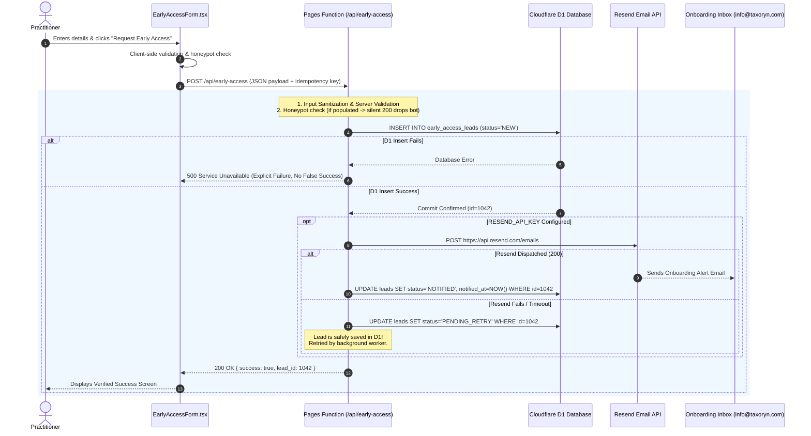

# TAXORYN MARKETING — EARLY ACCESS TARGET ARCHITECTURE
## Workstream 3: Principal Cloud Architect Zero-Lead-Loss Pipeline Specification

**Document Reference:** `ARCH-EA-2026-01`  
**Date:** November 22, 2026  
**Author:** Agent 4 (Principal Cloud Architect)  
**Target Pipeline:** `/api/early-access` on Cloudflare Pages Functions + Cloudflare D1  
**Status:** Approved Architectural Specification (Preflight Design)

---

## 1. Executive Summary

The Early Access onboarding pipeline is Taxoryn's primary commercial lead conversion channel. The previous audit identified a **P0 critical defect: zero database persistence and a silent lead drop** where enquiries vanished into a black hole when `RESEND_API_KEY` was missing or failed.

This document specifies the **Target Zero-Lead-Loss Architecture** built on **Cloudflare D1** (Serverless SQLite) and **Cloudflare Pages Functions**. It guarantees that:
1. **No Enquiry Is Ever Lost:** Every valid submission is committed to ACID-compliant database storage *before* any external notification is attempted.
2. **No False Success Responses:** The client receives HTTP 200 *only* after database persistence succeeds.
3. **Resilience to Downstream Outages:** If the Resend email API experiences downtime or quota exhaustion, the lead is safely retained in D1 with `status = 'PENDING_RETRY'` for automated retry.
4. **Abuse & Bot Prevention:** Honeypot field and edge rate limiting protect the database and email quotas from automated spam.



---

## 2. Cloudflare D1 Database Schema Specification

### 2.1 Table Definition: `early_access_leads`
The database table is deployed to Cloudflare D1 using standard SQLite syntax:

```sql
CREATE TABLE IF NOT EXISTS early_access_leads (
    id INTEGER PRIMARY KEY AUTOINCREMENT,
    lead_uuid TEXT NOT NULL UNIQUE,
    full_name TEXT NOT NULL,
    email TEXT NOT NULL,
    firm_name TEXT NOT NULL,
    phone TEXT,
    city TEXT,
    practice_size TEXT NOT NULL DEFAULT 'Not specified',
    primary_interest TEXT NOT NULL DEFAULT 'All Modules',
    utm_source TEXT,
    utm_medium TEXT,
    utm_campaign TEXT,
    utm_content TEXT,
    utm_term TEXT,
    idempotency_key TEXT UNIQUE,
    status TEXT NOT NULL CHECK(status IN ('NEW', 'NOTIFIED', 'PENDING_RETRY', 'FAILED_PERMANENT')) DEFAULT 'NEW',
    retry_count INTEGER NOT NULL DEFAULT 0,
    created_at TEXT NOT NULL DEFAULT (datetime('now')),
    notified_at TEXT,
    ip_hash TEXT
);

CREATE INDEX IF NOT EXISTS idx_leads_email ON early_access_leads(email);
CREATE INDEX IF NOT EXISTS idx_leads_status ON early_access_leads(status);
CREATE INDEX IF NOT EXISTS idx_leads_created_at ON early_access_leads(created_at);
```

---

## 3. Core Architectural Requirements & Solutions

### 3.1 Persistent Enquiry Storage
- **Binding Name:** `DB` mapped to Cloudflare D1 database `taxoryn-leads-db`.
- **Atomic Insertion:** The edge function executes a prepared statement:
  ```typescript
  const result = await context.env.DB.prepare(`
    INSERT INTO early_access_leads (
      lead_uuid, full_name, email, firm_name, phone, city,
      practice_size, primary_interest, utm_source, utm_campaign, idempotency_key
    ) VALUES (?, ?, ?, ?, ?, ?, ?, ?, ?, ?, ?)
  `).bind(
    crypto.randomUUID(), fullName, email, firmName, phone, city,
    practiceSize, primaryInterest, utmSource, utmCampaign, idempotencyKey
  ).run();
  ```
- **Durability Guarantee:** If the D1 write succeeds, the lead is safely recorded on the Cloudflare global network regardless of downstream network events.

### 3.2 Server-Side Validation & Sanitization
- **Sanitization:** Input strings are stripped of HTML tags (`replace(/[<>]/g, "")`), trimmed of leading/trailing whitespace, and capped at 500 characters to prevent buffer and injection attacks.
- **Email Validation:** RFC 5322 compliant regex: `/^[a-zA-Z0-9.!#$%&'*+/=?^_`{|}~-]+@[a-zA-Z0-9-]+(?:\.[a-zA-Z0-9-]+)*$/`.
- **Phone Validation:** Accepts E.164 or Indian 10-digit mobile formats (`/^[+]?[\d\s-]{8,15}$/`).

### 3.3 Honeypot & Anti-Spam Protection
- **Honeypot Field:** The client form embeds an invisible field `<input type="text" name="website_url" className="hidden" tabIndex={-1} autoComplete="off" />`.
- **Bot Rejection:** If `body.website_url` is populated, the function immediately returns HTTP 200 with generic success, silently dropping the bot submission without writing to D1 or sending emails.
- **Edge Rate Limiting:** Enforced via Cloudflare WAF Rate Limiting rule: max 5 requests per 10 minutes per IP on path `/api/early-access`.

### 3.4 Idempotency Handling
- **Idempotency Key:** Client computes a SHA-256 hash of `email + current_date_YYYY_MM_DD` or passes a generated UUID.
- **D1 Unique Constraint:** If the same practitioner clicks "Submit" twice within the same day, D1 catches the `UNIQUE(idempotency_key)` violation. The function catches code `SQLITE_CONSTRAINT` and returns the existing success response without duplicate email alerts.

### 3.5 Resend Notification & Retry Strategy
1. **Primary Dispatch:** Attempt immediate outbound call to `https://api.resend.com/emails` with a 4,000ms timeout.
2. **Success:** Update D1 record: `UPDATE early_access_leads SET status='NOTIFIED', notified_at=datetime('now') WHERE id=?`.
3. **Failure Handling (Provider Down):**
   - If Resend returns 429 (rate limit), 500 (service down), or network times out:
   - Catch error, update D1 record: `UPDATE early_access_leads SET status='PENDING_RETRY', retry_count = retry_count + 1 WHERE id=?`.
   - **Crucial Rule:** The function still returns HTTP 200 to the user! Why? Because the lead is **safely stored in D1**. The user is not burdened by an email provider failure.
4. **Retry Mechanism:**
   - A scheduled Cloudflare Cron Trigger (running every 30 minutes) queries:
     ```sql
     SELECT * FROM early_access_leads WHERE status = 'PENDING_RETRY' AND retry_count < 5;
     ```
   - Retries email delivery with exponential backoff.

### 3.6 PII Minimization & Data Governance
- **Zero Third-Party PII Exposure:** Analytics trackers (`lib/analytics/`) never receive applicant names, emails, or phone numbers.
- **Access Control:** The D1 database has no public read endpoint. Leads are accessed only by authorized team administrators via the Cloudflare Dashboard or authenticated Wrangler CLI queries (`wrangler d1 execute taxoryn-leads-db --command "SELECT * FROM early_access_leads"`).
- **Retention Policy:** Enforce automatic purging of un-contacted leads older than 180 days in compliance with the Indian Digital Personal Data Protection (DPDP) Act 2023.

---

## 4. Operational Comparison: Legacy vs Target Design

| Dimension | Legacy Implementation | Target D1 Architecture |
|---|---|---|
| **Storage Persistence** | 0% (None) | **100% ACID Database Durability** |
| **Resend Failure Reaction** | Silent lead drop (Permanently lost) | **Retained in D1; queued for retry** |
| **Missing API Key Behavior**| Fake success, lead lost | **Stored in D1; available for manual export** |
| **Bot & Spam Protection** | None | **Hidden honeypot + Edge rate limiting** |
| **Duplicate Prevention** | None | **Idempotent submission key** |
| **Infrastructure Cost** | $0 | **$0 (Included in Cloudflare Free Tier)** |

---

## 5. Architectural Approval Verdict

**Target Early Access Pipeline Status:** **APPROVED SPECIFICATION**  
Ready for implementation on Cloudflare Pages upon completion of the preflight migration authorization.
