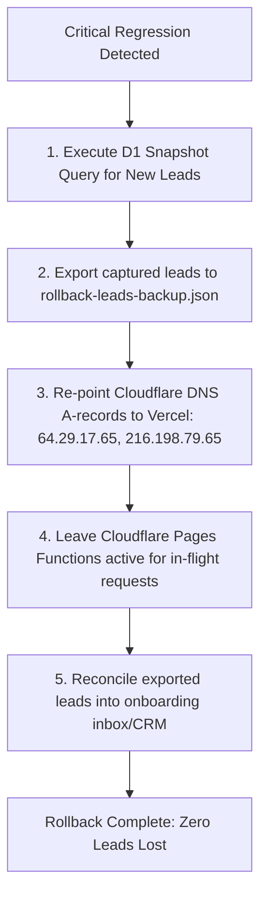

# TAXORYN MARKETING — FINAL CUTOVER & MIGRATION READINESS CHECKLIST
## Workstream: Agent 4 Principal Cloud Architect Preflight Gate Certification

**Document Reference:** `CHK-CUTOVER-2026-01`  
**Date:** November 22, 2026  
**Author:** Agent 4 (Principal Cloud Architect)  
**Mode:** STRICTLY READ-ONLY ASSESSMENT  

---

## 1. Formal Governance Decision & Gate Classification

In strict compliance with release governance standards, the release status is categorized into three distinct, unambiguous dimensions:

### 1.1 Architecture Design: **APPROVED**
The **Cloudflare Pages + Pages Functions + Cloudflare D1 Database** architecture is formally approved as the authoritative target production model for Taxoryn marketing.

### 1.2 Migration Prerequisites: **OUTSTANDING (UNSATISFIED)**
While the architecture is fully designed and certified, the required Cloudflare D1 database, edge bindings, production secrets, and R2 storage buckets **have not yet been provisioned in the live Cloudflare organization**.

### 1.3 Production Cutover Authorization: **NOT AUTHORIZED (NO-GO)**
**Production cutover to Cloudflare Pages is strictly NOT AUTHORIZED.**  
Cutover authorization will only be granted after every prerequisite in this checklist is evidenced on the preview deployment.

---

## 2. Migration Prerequisites Status Matrix

| ID | Prerequisite Item | Required Operational Action | Current Status | Evidence / Verification Method |
|---|---|---|---|---|
| **PRE-01** | **D1 Database Creation** | Provision Cloudflare D1 database `taxoryn-leads-db`. | **OUTSTANDING** | Requires `wrangler d1 list` to show database. |
| **PRE-02** | **D1 Schema Deployment** | Execute `schema.sql` to create `early_access_leads` table & indices. | **OUTSTANDING** | Requires `wrangler d1 execute` schema validation. |
| **PRE-03** | **Pages D1 Binding** | Bind variable `DB` to `taxoryn-leads-db` in Cloudflare Pages dashboard. | **OUTSTANDING** | Requires Cloudflare Pages dashboard function settings inspect. |
| **PRE-04** | **Production Secrets** | Populate `RESEND_API_KEY`, `RESEND_FROM_EMAIL`, `TAXORYN_NOTIFICATION_EMAIL`. | **OUTSTANDING** | Requires Cloudflare Pages secrets listing. |
| **PRE-05** | **Android APK Hosting** | Upload `taxoryn-preview.apk` to Cloudflare R2 bucket (`taxoryn-v1.0.0.apk`). | **OUTSTANDING** | Requires public HTTP HEAD test on R2 download URL. |
| **PRE-06** | **Download URL Variable** | Set `NEXT_PUBLIC_ANDROID_DOWNLOAD_URL` in Cloudflare Pages variables. | **OUTSTANDING** | Requires build log verification of env injection. |
| **PRE-07** | **Security Headers File** | Include hardened `public/_headers` (omitting `'unsafe-eval'`). | **OUTSTANDING** | Requires file presence in deployment artifact. |
| **PRE-08** | **Preview Staging Test** | Verify 38 routes & submit synthetic lead on `taxoryn-marketing.pages.dev`. | **OUTSTANDING** | Requires HTTP 200 on preview URL + D1 query verification. |
| **PRE-09** | **DNS TTL Conditioning** | Lower Vercel apex A-record TTL to 120s / Auto 24 hours before cutover. | **OUTSTANDING** | Requires `dig` / `dns.resolve4` TTL inspection. |
| **PRE-10** | **Edge SSL Active** | Verify Universal SSL certificate is issued and Active for `taxoryn.com`. | **OUTSTANDING** | Requires Cloudflare Pages custom domain status check. |

---

## 3. End-to-End Cutover Execution Checklist

### Phase 1: Pre-Cutover Staging Verification (Zero-DNS-Risk)
*All actions in Phase 1 execute on Cloudflare Pages preview URLs without touching `taxoryn.com` DNS.*

- [ ] 1. Merge verified `prod_demo` into `main` on GitHub.
- [ ] 2. Confirm Cloudflare Pages builds `out/` and bundles `functions/api/early-access.ts`.
- [ ] 3. Open preview deployment URL: `https://prod-demo.taxoryn-marketing.pages.dev`.
- [ ] 4. Probe core commercial routes on preview:
  - [ ] `https://prod-demo.taxoryn-marketing.pages.dev/` (HTTP 200)
  - [ ] `https://prod-demo.taxoryn-marketing.pages.dev/platform` (HTTP 200)
  - [ ] `https://prod-demo.taxoryn-marketing.pages.dev/how-it-works` (HTTP 200)
  - [ ] `https://prod-demo.taxoryn-marketing.pages.dev/download` (HTTP 200)
  - [ ] `https://prod-demo.taxoryn-marketing.pages.dev/about` (HTTP 200)
- [ ] 5. Submit synthetic test lead on preview `/early-access`.
- [ ] 6. Query D1 database to verify row persistence:
  ```bash
  npx wrangler d1 execute taxoryn-leads-db --command "SELECT * FROM early_access_leads WHERE email LIKE 'test-%' LIMIT 1;"
  ```
- [ ] 7. Confirm test email notification arrived in `info@taxoryn.com` onboarding inbox.
- [ ] 8. Delete synthetic test row from D1 database.

### Phase 2: Pre-Cutover DNS & Certificate Preparation
- [ ] 1. In Cloudflare DNS, verify apex A-records for `taxoryn.com` have TTL set to 120 seconds.
- [ ] 2. In Cloudflare Pages *taxoryn-marketing* $\rightarrow$ *Custom domains*, add `taxoryn.com` and `www.taxoryn.com`.
- [ ] 3. Confirm Cloudflare displays **"Domain Active"** and **"SSL Certificate Issued"**.

### Phase 3: Cutover Execution
- [ ] 1. Confirm Cloudflare CNAME flattening routes apex traffic to `taxoryn-marketing.pages.dev`.
- [ ] 2. Enable Cloudflare Proxy (Orange Cloud) on apex records.
- [ ] 3. Record official cutover start timestamp (UTC).

### Phase 4: Post-Cutover Verification Matrix
- [ ] 1. `curl -I https://taxoryn.com/` returns HTTP 200 with `server: cloudflare`.
- [ ] 2. `curl -I https://taxoryn.com/platform` returns HTTP 200 (Resolves BLK-01).
- [ ] 3. `curl -I https://taxoryn.com/how-it-works` returns HTTP 200 (Resolves BLK-01).
- [ ] 4. `curl -I https://taxoryn.com/download` returns HTTP 200 (Resolves BLK-01).
- [ ] 5. Direct APK download button on `/download` points to `download.taxoryn.com/taxoryn-v1.0.0.apk`.
- [ ] 6. Header inspection confirms active security headers:
  - `X-Frame-Options: SAMEORIGIN`
  - `X-Content-Type-Options: nosniff`
  - `Strict-Transport-Security: max-age=86400`
  - `Content-Security-Policy` active (with zero `'unsafe-eval'`).
- [ ] 7. Submit one live production test enquiry and verify receipt in D1 and onboarding inbox.
- [ ] 8. Confirm `https://app.taxoryn.com` remains completely operational and unaffected.

---

## 4. Rollback & Post-Migration Data Preservation Protocol

If an unexpected critical regression occurs post-cutover:



1. **Step 1 — Immediate Lead Preservation:**
   ```bash
   npx wrangler d1 execute taxoryn-leads-db --command "SELECT * FROM early_access_leads WHERE created_at >= '<cutover_start_timestamp>';" --json > ./rollback-leads-backup.json
   ```
2. **Step 2 — Immediate DNS Reversion:**
   In Cloudflare DNS, edit `taxoryn.com` A-records:
   - A `taxoryn.com` $\rightarrow$ `64.29.17.65` (DNS only / unproxied)
   - A `taxoryn.com` $\rightarrow$ `216.198.79.65` (DNS only / unproxied)
3. **Step 3 — Preserve Edge Pipeline:**
   Do **NOT** delete the Cloudflare Pages project. In-flight client sessions will continue writing to D1 until their local DNS cache expires.
4. **Step 4 — Manual Lead Ingestion:**
   Deliver `rollback-leads-backup.json` to the Taxoryn operations team for immediate follow-up.

---

## 5. Final Architect Sign-Off Gate

| Governance Milestone | Gate Requirement | Decision |
|---|---|---|
| **Architecture Design Gate** | Option A (Cloudflare Pages + Functions + D1) evaluated, hardened, and verified. | **APPROVED** |
| **Prerequisites Gate** | Cloudflare D1 database, R2 APK bucket, and secrets provisioned in live account. | **OUTSTANDING** |
| **Production Cutover Gate** | Authorization to modify production DNS and route public traffic. | **NOT AUTHORIZED** |

**Directive to Release Team:**  
Do **NOT** modify production DNS or execute cutover until all 10 prerequisites are provisioned and certified on the preview staging deployment.
