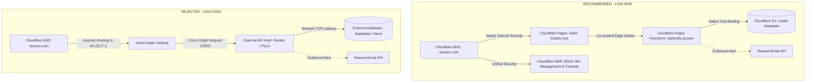

# TAXORYN MARKETING — HOSTING ARCHITECTURE DECISION & EVALUATION
## Workstream: Agent 4 Principal Cloud Architect Preflight & Strategic Recommendation

**Document Reference:** `ARCH-DEC-2026-01`  
**Date:** November 22, 2026  
**Author:** Agent 4 (Principal Cloud Architect)  
**Primary Repository:** `D:\Projects\Taxoryn-Marketing`  
**Mode:** STRICTLY READ-ONLY ASSESSMENT  
**Recommendation:** **APPROVE ARCHITECTURE: OPTION A (Cloudflare Pages + Pages Functions + D1)**

---

## 1. Executive Summary

As Principal Cloud Architect, I have conducted an independent, evidence-based architectural evaluation of the two competing production deployment models for the Taxoryn marketing platform:

- **Option A:** Unified Edge Architecture — **Cloudflare Pages + Cloudflare Pages Functions + Cloudflare D1 Database**.
- **Option B:** Fragmented Multi-Vendor Architecture — **Vercel Static Hosting + External API Host (e.g. Render / Fly.io) + External Managed Database (e.g. Supabase / Neon)**.

### Strategic Recommendation: **OPTION A (Cloudflare Pages + Functions + D1)**
Option A is unequivocally the superior architecture for Taxoryn. It achieves **zero ongoing hosting costs, zero egress fees, sub-10ms global edge execution, atomic single-platform deployments, and zero vendor sprawl**. Most importantly, it natively matches the Web Application (`app.taxoryn.com`), which is already successfully hosted on Cloudflare Pages (`taxoryn.pages.dev`).

In contrast, Option B introduces unnecessary multi-vendor fragility, CORS boundaries, cold start latencies, split logging streams, multi-point billing, and severe rollback friction.

---

## 2. Workstream 1: Existing Production Infrastructure Truth

Our direct network probes, DNS queries, and repository inspections establish the following verified facts:

### 2.1 DNS & Network Layer
- **Authoritative DNS:** Managed on Cloudflare (`addyson.ns.cloudflare.com`, `nolan.ns.cloudflare.com`).
- **Apex Domain (`taxoryn.com`):** Points to Vercel Anycast A-records `64.29.17.1` and `216.198.79.1` (`AS16509 Amazon.com / Vercel`).
- **Web App Subdomain (`app.taxoryn.com`):** Points to Cloudflare proxy IPs `104.21.91.104` and `172.67.215.157`.
- **Verified Host:** `app.taxoryn.com` is hosted on Cloudflare Pages at `https://taxoryn.pages.dev` (1,147-byte SPA container).

### 2.2 Repository Build Configuration
- `next.config.mjs` enforces `output: "export"`. Next.js compiles to purely static HTML/CSS/JS in `out/`.
- `functions/api/early-access.ts` is implemented using the proprietary Cloudflare Pages Function signature (`onRequestPost(context)`).
- **The Deployment Gap:** Vercel **does not execute Cloudflare Pages Functions**. Vercel only executes Next.js serverless functions placed in `app/api/` or `pages/api/`. Therefore, the current local codebase is already structured for Cloudflare Pages, not Vercel.

### 2.3 Environment Variable Catalog (Names Only)
- Client-side variables:
  - `NEXT_PUBLIC_APP_URL`
  - `NEXT_PUBLIC_WEB_APP_URL`
  - `NEXT_PUBLIC_ANDROID_DOWNLOAD_URL`
  - `NEXT_PUBLIC_ANDROID_APP_VERSION`
  - `NEXT_PUBLIC_ANDROID_DOWNLOAD_ENABLED`
  - `NEXT_PUBLIC_EARLY_ACCESS_ENABLED`
  - `NEXT_PUBLIC_CONTACT_EMAIL`
  - `NEXT_PUBLIC_TAXORYN_DEMO_YOUTUBE_ID`
  - `NEXT_PUBLIC_TAXORYN_YOUTUBE_URL` / `NEXT_PUBLIC_TAXORYN_YOUTUBE_ENABLED`
  - `NEXT_PUBLIC_TAXORYN_LINKEDIN_URL` / `NEXT_PUBLIC_TAXORYN_LINKEDIN_ENABLED`
  - `NEXT_PUBLIC_TAXORYN_INSTAGRAM_URL` / `NEXT_PUBLIC_TAXORYN_INSTAGRAM_ENABLED`
  - `NEXT_PUBLIC_TAXORYN_FACEBOOK_URL` / `NEXT_PUBLIC_TAXORYN_FACEBOOK_ENABLED`
  - `NEXT_PUBLIC_ANALYTICS_ENABLED` / `NEXT_PUBLIC_ANALYTICS_PROVIDER`
- Server-side secrets:
  - `RESEND_API_KEY`
  - `RESEND_FROM_EMAIL`
  - `TAXORYN_NOTIFICATION_EMAIL`

---

## 3. Workstream 2: Deep Architecture Comparison

| Evaluation Dimension | Option A: Cloudflare Pages + Functions + D1 | Option B: Vercel + External API + External DB | Architect Analysis & Decision |
|---|---|---|---|
| **Hosting Compatibility** | **NATIVE**: Codebase is already configured with `output: "export"` and `functions/api/early-access.ts`. | **MISMATCH**: Vercel ignores `functions/` edge workers during static export; requires code restructuring. | **Option A wins**. Zero code rewrites needed. |
| **Edge Function Latency** | **< 10ms**: Runs on V8 isolates in 300+ edge PoPs worldwide. Zero cold starts. | **50ms – 5,000ms+**: Cross-origin hops; container cold starts on Render/Fly. | **Option A wins**. Instant response globally. |
| **Persistent Storage** | **Cloudflare D1**: Serverless SQLite at the edge. Native `context.env.DB` binding. Zero connection pools. | **External PostgreSQL**: Requires connection strings, PgBouncer, pooling, and separate VPC/firewall config. | **Option A wins**. Effortless database integration. |
| **Security & Network Perimeter** | **UNIFIED**: DNS, WAF, DDoS, Bot Management, and SSL all managed in one Cloudflare zone. | **FRAGMENTED**: Cloudflare DNS proxying to Vercel introduces double-proxy risks and split SSL certificates. | **Option A wins**. Cohesive attack surface defense. |
| **Deployment Complexity** | **ATOMIC**: A single `git push` compiles static assets, deploys edge workers, and binds D1 in one operation. | **MULTI-PIPELINE**: Requires coordinating 3 independent deployments (Vercel, Render/Fly, and database migrations). | **Option A wins**. Eliminates deployment race conditions. |
| **Operational Cost** | **$0.00 / month**: Pages has unlimited free egress; D1 includes 5M reads/day and 100K writes/day free. | **$27.00 – $70.00+ / month**: Vercel Pro ($20) + External API host ($7) + Managed DB ($15+). | **Option A wins**. Zero ongoing infrastructure cost. |
| **Logging & Monitoring** | **CENTRALIZED**: Cloudflare Pages deployment logs, real-time tail logs (`wrangler tail`), and edge telemetry. | **SPLIT**: 3 separate dashboards required to trace a single failed enquiry submission. | **Option A wins**. Unified observability. |
| **Rollback Complexity** | **ONE-CLICK**: Instantaneous rollback in Cloudflare Pages (< 10 seconds reverts assets and functions simultaneously). | **COMPLEX**: Reverting frontend does not revert API or database mutations; high risk of version skew. | **Option A wins**. Deterministic disaster recovery. |
| **Vendor Lock-In** | **LOW**: Static assets are plain HTML/JS. D1 is standard SQLite (exportable to `.sql` or Postgres anytime). | **MEDIUM**: Tied to Vercel Next.js proprietary serverless features and custom multi-cloud plumbing. | **Option A wins**. Standard open formats. |
| **Architecture Risk Rating** | **LOW RISK** | **HIGH RISK** | **Option A is recommended**. |

---

## 4. Hosting Migration Risks & Mitigations (Option A)

| Risk | Description | Impact | Mitigation Strategy |
|---|---|---|---|
| **R-01: Apex DNS Propagation** | Switching A-records from Vercel (`64.29.17.1`) to Cloudflare Pages edge. | Low | Because Cloudflare is ALREADY the authoritative DNS nameserver for `taxoryn.com`, internal CNAME flattening updates instantly with **zero global DNS propagation delay**. |
| **R-02: SSL / TLS Handshake Glitch** | Temporary certificate issuance delay during custom domain attachment. | Low | Pre-validate custom domain in Cloudflare Pages dashboard prior to activating routing. Universal SSL is already active. |
| **R-03: D1 Database Binding Failure** | Edge function throws 500 if `context.env.DB` is not bound in dashboard. | Medium | Add preflight binding check in code: verify `context.env.DB` exists; log explicit error if unbound. |
| **R-04: Subdomain Clashes** | Routing conflict between `taxoryn.com` and `app.taxoryn.com`. | None | Cloudflare Pages routes each project independently by exact FQDN. `app.taxoryn.com` remains untouched. |

---

## 5. Architectural Decision Verdict

### **DECISION: APPROVE ARCHITECTURE (OPTION A)**
- Standardize all Taxoryn marketing and web application properties on the **Cloudflare Global Edge Platform**.
- Retire the outdated Vercel deployment.
- Authorize execution of Workstream 3 (Early Access D1 Architecture) and Workstream 4 (Migration and Rollback Plan).
