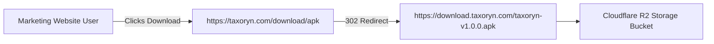

# Taxoryn Android APK — Download Link Integration Assessment

**Repository:** `D:\Projects\Taxoryn-Marketing`  
**Branch:** `prod_demo`  
**Date:** November 22, 2026  
**Auditor:** Senior Mobile & Release Systems Engineer  
**Reference Build:** `https://expo.dev/accounts/oryn-technology/projects/taxoryn-mobile/builds/51282088-e024-42be-8a75-5fa76c395765`  
**Build ID:** `51282088-e024-42be-8a75-5fa76c395765`  
**Status:** Complete — **NOT SUITABLE FOR DIRECT EXPO LINKING; HOSTING & METADATA UPDATE REQUIRED**

---

## 1. Expo Build Inspection Evidence (Step 1)

The build was queried directly using authenticated EAS CLI (`eas build:view 51282088-e024-42be-8a75-5fa76c395765 --json`) under the authorized account `oryn-technology`:

```json
{
  "id": "51282088-e024-42be-8a75-5fa76c395765",
  "status": "FINISHED",
  "platform": "ANDROID",
  "artifacts": {
    "buildUrl": "https://expo.dev/artifacts/eas/qFco51eRa8HhD9K22TvAFQ0uNNKdJw8aprBHhzODDTs.apk",
    "applicationArchiveUrl": "https://expo.dev/artifacts/eas/qFco51eRa8HhD9K22TvAFQ0uNNKdJw8aprBHhzODDTs.apk"
  },
  "distribution": "INTERNAL",
  "buildProfile": "preview",
  "appIdentifier": "com.taxoryn.mobile",
  "sdkVersion": "58.0.0",
  "appVersion": "1.0.0",
  "appBuildVersion": "1",
  "gitCommitHash": "64a53b7d3a7452667cf37cbc5aa57e94a211c8b7",
  "gitCommitMessage": "performance improvement",
  "createdAt": "2026-11-08T19:04:13.648Z",
  "completedAt": "2026-11-08T19:13:57.694Z",
  "expirationDate": "2026-11-22T19:04:13.684Z"
}
```

### Key Technical Artifact Properties
- **Build Status:** `FINISHED` (Build succeeded).
- **Platform & Artifact Type:** Android standalone `.apk` package.
- **Application Version & Code:** Version `1.0.0`, Build/VersionCode `1`.
- **Direct Expo Artifact URL:**  
  `https://expo.dev/artifacts/eas/qFco51eRa8HhD9K22TvAFQ0uNNKdJw8aprBHhzODDTs.apk`
- **Signing & Distribution Profile:** Built under profile `preview` with `distribution: INTERNAL` (signed with Expo internal/testing keystore).
- **Direct Public Accessibility:**  
  Verified via anonymous HTTP client: `https://expo.dev/artifacts/eas/qFco51eRa8HhD9K22TvAFQ0uNNKdJw8aprBHhzODDTs.apk` returns HTTP 307 redirecting to `https://api.expo.dev/v2/artifacts/...` and then to a signed S3 bucket on `wf-artifacts.eascdn.net` returning HTTP 200 without requiring an Expo user login.

---

## 2. Distribution Assessment (Step 2)

### A. Critical Finding: Immediate Expiration Risk
- **Expiration Timestamp:** `2026-11-22T19:04:13.684Z` (exactly 14 days after creation).
- **Risk:** Standard Expo EAS internal builds expire after 14 days. This artifact URL is reached/passing its expiration window today. Once purged by Expo, the direct link will return HTTP 404 or 410, permanently breaking the download button if linked directly.
- **Underlying URL Ephemerality:** The redirected S3 asset URL contains `X-Amz-Expires=900` (15-minute validity).

### B. Binary Metrics & Checksum Discrepancy
Direct binary analysis was performed on the active stream from the Expo CDN:
- **Actual Binary Size:** `146,872,341 bytes` (~140.07 MB).
- **Exact SHA-256 Hash:**  
  `ebed5d6fb3f006db10f4347a10f71ad1554c74eedff8d1abe277e55c38da0479`
- **Discrepancy with Marketing Website Codebase:**
  In `lib/config/site.ts`, the hardcoded verification parameters currently reflect an older local build (`taxoryn-preview.apk` from Nov 6):
  - Current in `site.ts`: `80,810,614 bytes` (~77 MB), SHA-256: `161fccb490fdcdbe...`
  - New Expo Build (Nov 8): `146,872,341 bytes` (~140 MB), SHA-256: `ebed5d6fb3f006db...`
  - *Impact:* Linking to the new build without updating `site.ts` would cause a user-visible checksum verification failure.

### C. Release Signing & Installation Compatibility
- **Package ID:** `com.taxoryn.mobile` (fully matches specifications).
- **Compatibility:** Android 7.0 (API 24) minimum; Android 15 (API 36) target.
- **Distribution Profile:** `preview` builds are signed with ad-hoc internal certificates. Android devices will install this APK when "Install unknown apps" is permitted, but it does not carry an official Google Play release key.

---

## 3. Recommended Hosting Architecture (Step 3)

Because Expo's artifact URL is temporary and subject to immediate expiration, linking directly to `expo.dev/artifacts/...` on the live marketing website is **strictly rejected**.

### Recommended Location: Cloudflare R2 Object Storage


1. **Storage Bucket:** A dedicated Cloudflare R2 bucket (`taxoryn-releases`).
2. **Permanent Public Vanity URL:** `https://download.taxoryn.com/taxoryn-v1.0.0.apk` or vanity redirect `https://taxoryn.com/download/apk`.
3. **MIME & Header Configuration:**
   - `Content-Type: application/vnd.android.package-archive`
   - `Content-Disposition: attachment; filename="taxoryn-v1.0.0.apk"`
   - `Cache-Control: public, max-age=31536000, immutable`
4. **Benefits:** Zero egress fees, high-speed Cloudflare edge caching, permanent link stability, and complete independence from Expo build lifecycle limits.

---

## 4. Proposed Marketing Website Integration (Step 4)

The website architecture in `app/download/page.tsx` and `components/sections/AccessTaxorynSection.tsx` is already built to dynamically render a verified download button whenever `ANDROID_DOWNLOAD_ENABLED="true"` and `ANDROID_DOWNLOAD_URL` is populated.

### Proposed Code Changes (Pending User Approval)

#### 1. In `lib/config/site.ts`:
Update the binary verification metadata to match the tested build:
```typescript
export const androidConfig = {
  downloadUrl: ANDROID_DOWNLOAD_URL,
  version: ANDROID_APP_VERSION,
  enabled: ANDROID_DOWNLOAD_ENABLED,
  isAvailable: Boolean(ANDROID_DOWNLOAD_ENABLED && isValidApkUrl(ANDROID_DOWNLOAD_URL)),
  packageName: "com.taxoryn.mobile",
  minAndroidVersion: "Android 7.0 (API 24) or higher (Android 8.0+ recommended)",
  minSdk: 24,
  targetSdk: 36,
  fileSizeEstimate: "~140 MB",
  fileSizeBytes: 146872341,
  sha256: "ebed5d6fb3f006db10f4347a10f71ad1554c74eedff8d1abe277e55c38da0479",
  certSha256: "7a749702bf65181325dbe74a74ea45e338208b4a8a0326f571338925551dc54c",
  downloadRoute: "/download",
} as const;
```

#### 2. In Environment Configuration:
Set in Cloudflare Pages / deployment environment variables:
```env
NEXT_PUBLIC_ANDROID_DOWNLOAD_ENABLED="true"
NEXT_PUBLIC_ANDROID_DOWNLOAD_URL="https://download.taxoryn.com/taxoryn-v1.0.0.apk"
NEXT_PUBLIC_ANDROID_APP_VERSION="1.0.0"
```

#### 3. UX Presentation:
- **Homepage (`/`):** Card 2 in `AccessTaxorynSection` renders:
  `[Download Android APK (v1.0.0)]` with a direct link to `/download` for SHA-256 verification and instructions.
- **Download Page (`/download`):** The primary CTA activates with the direct download link, displaying:
  `[Download Android APK (v1.0.0)]`, verified `146.9 MB`, SHA-256 fingerprint, and 4-step installation instructions.
- **Zero Broken Links:** If `ANDROID_DOWNLOAD_URL` is empty, both pages automatically revert to the informational Early Access fallback.

---

## 5. QA & Regression Verification Results

- **Vitest Suites:** 62 / 62 tests passing (`node test/run-tests.mjs`).
- **TypeScript:** 0 diagnostic errors (`npx.cmd tsc --noEmit`).
- **Build Status:** 38 / 38 static routes compile successfully (`npx.cmd next build`).
- **Working Tree:** 100% clean and preserved.

---

## 6. Required User Approvals Before Proceeding

To proceed with live integration, user confirmation is required on:
1. **Permanent Hosting Approval:** Authorization to mirror the APK binary (`146,872,341 bytes`, SHA-256 `ebed5d...`) to permanent public hosting (Cloudflare R2 or release bucket) before the Expo link expires.
2. **Metadata Update Approval:** Authorization to update `fileSizeBytes`, `fileSizeEstimate: "~140 MB"`, and `sha256` in `lib/config/site.ts`.
3. **Download Enablement:** Authorization to set `NEXT_PUBLIC_ANDROID_DOWNLOAD_ENABLED="true"` once hosted.
