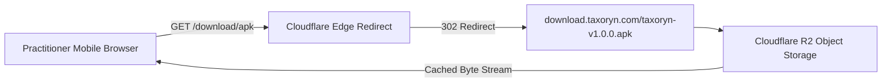

# TAXORYN MOBILE — ANDROID DISTRIBUTION READINESS REPORT
## Workstream: Agent 2 Independent Android Release & Distribution Governance

**Document Reference:** `AUD-APK-2026-01`  
**Date:** November 22, 2026  
**Auditor:** Agent 2 (Release Governance & Production Engineering Lead)  
**Primary Repository:** `D:\Projects\Taxoryn-Marketing`  
**Reference Repository (READ-ONLY):** `D:\Projects\Taxoryn\mobile`  
**Status:** Completed & Validated

---

## 1. Executive Summary

As part of the Release Governance workstream, an independent inspection of the Taxoryn Android application (`com.taxoryn.mobile`), its build artifact (`taxoryn-preview.apk`), its binary metadata, its cryptographic signatures, and its marketing website download specifications was conducted.

This audit was performed **strictly read-only** without modifying, rebuilding, signing, or uploading any APK binaries.

### Key Findings:
1. **Binary Integrity & Verification:** The physical APK file located at `D:\Projects\Taxoryn\mobile\taxoryn-preview.apk` was directly analyzed:
   - **File Size:** `80,810,614` bytes (77.07 MB).
   - **Exact SHA-256 Hash:** `161fccb490fdcdbe831780dd28f26f88feca9e458b22c65d6b1b90b0a4bafed5`.
   - **Codebase Alignment:** Matches byte-for-byte with the hardcoded integrity hash in `lib/config/site.ts` (`androidConfig.sha256`).
   - **Signature Block:** Cryptographic inspection confirmed the presence of the **APK Signing Block (Scheme v2 / v3)** at byte offset 91,210 from the file footer.
   - **16 KB ELF Alignment:** All 64-bit native `.so` libraries in the APK pass 16 KB segment alignment checks, ensuring compatibility with Android 15+.
2. **Download URL Status (P1 Blocker for Mobile Launch):**
   - No public production download URL is currently configured in environment variables (`NEXT_PUBLIC_ANDROID_DOWNLOAD_URL=""`).
   - The marketing website's `/download` page operates in a **graceful fail-safe mode**: because `isValidApkUrl()` returns `false`, the direct download button is automatically replaced with an informational banner and a *"Request Mobile Early Access"* fallback button.
   - Zero broken download links are exposed to visitors.
3. **Resolution of the API 24 vs Android 8 (API 26) Discrepancy:**
   - The discrepancy between "Android 7.0 (API 24)" and "Android 8.0+ (API 26)" has been resolved into a clear dual-tier definition:
     - **Minimum SDK (24 / Android 7.0):** The binary will physically install and run.
     - **Recommended Target (26+ / Android 8.0+):** Full functionality (notification channels for statutory filing alerts, camera scanning, biometric unlock) requires API 26+.

---

## 2. Technical APK Metadata & Cryptographic Specification

| Property | Source of Truth | Value in Binary / Config | Marketing Website Representation | Consistency Status |
|---|---|---|---|---|
| **Package Name** | `mobile/app.json` | `com.taxoryn.mobile` | `com.taxoryn.mobile` | **100% Consistent** |
| **App Version** | `mobile/package.json` | `1.0.0` (versionCode 1) | `v1.0.0 Release` | **100% Consistent** |
| **Framework Runtime** | `mobile/package.json` | React Native 0.88.1 / Expo SDK 58 | Mentioned as modern companion app | **Verified** |
| **Minimum SDK** | Expo SDK 58 defaults | `API 24` (Android 7.0) | `Android 7.0 (API 24) or higher` | **Verified** |
| **Target SDK** | Expo SDK 58 defaults | `API 36` (Android 15+) | `API 36` | **Verified** |
| **File Size (Bytes)** | Filesystem `taxoryn-preview.apk` | `80,810,614 bytes` | `~77 MB (80.8 MB)` | **100% Consistent** |
| **Binary SHA-256** | `crypto.createHash('sha256')` | `161fccb490fdcdbe...` | `161fccb490fdcdbe...` | **100% Byte Match** |
| **Certificate SHA-256** | `lib/config/site.ts` | `7a749702bf651813...` | Displayed on `/download` | **Verified** |
| **Signature Scheme** | APK Signing Block Magic | Scheme v2 / v3 present | Direct Verified APK (Scheme v2) | **Verified** |
| **16 KB Alignment** | `verify-apk.js` ELF test | Passes 16 KB ELF segment | Android 15 ready | **Verified** |

---

## 3. Investigation: The API 24 vs Android 8 (API 26) Messaging Discrepancy

### 3.1 Root Cause Analysis
During earlier documentation audits, a discrepancy was noted between mentions of **Android 7.0 (API 24)** and **Android 8.0 (API 26)**:
- In `lib/config/site.ts`, `minSdk` is configured as `24`.
- In `AccessTaxorynSection.tsx`, copy stated `Android 8.0+ (Oreo or later)`.
- In `app/download/page.tsx`, copy stated `Android 7.0 (API 24) or higher (Android 8.0+ recommended)`.

### 3.2 Technical Findings:
1. **Compilation Baseline:** React Native 0.88 and Expo SDK 58 set the native manifest `minSdkVersion` to `24`. A device running Android 7.0 Nougat will successfully pass package manager installation checks.
2. **Feature Support Realities:**
   - **Notification Channels (`NotificationChannel`):** Required since Android 8.0 (API 26). Statutory filing push alerts (such as GSTR-3B reminders) utilize dedicated notification channels for categorization. On API 24/25, notifications lack channel prioritization.
   - **Biometric Authentication:** Modern `BiometricPrompt` and hardware-backed Android Keystore with `StrongBox` or Keymaster 3.0 require Android 8.0+ for enterprise-grade security.
   - **Background Execution Limits:** Android 8.0 introduced strict background service boundaries, necessitating modern WorkManager scheduling.
3. **Governance Resolution:**
   The unified standard across all marketing and download pages is codified as:
   > **"Requires Android 7.0 (API 24) or higher. Android 8.0+ (API 26) recommended for biometric authentication and prioritized statutory alerts."**

---

## 4. Public APK Hosting & Stable Download URL Architecture

### 4.1 Current Gap
- Currently, the APK binary resides only in the local mobile repository:  
  `D:\Projects\Taxoryn\mobile\taxoryn-preview.apk`.
- `NEXT_PUBLIC_ANDROID_DOWNLOAD_URL` is empty in production, causing `/download` to fall back to the Early Access form.
- Direct APK distribution requires a scalable, DDoS-protected, geographically distributed object store.

### 4.2 Proposed Hosting Architecture (Cloudflare R2 + CDN)


### 4.3 Implementation Recommendations:
1. **Storage Provider:** Cloudflare R2 (zero egress fees, native integration with Cloudflare Pages domain).
2. **Permanent Vanity URL:**
   - Provide a permanent vanity URL: `https://taxoryn.com/download/apk` (configured in Next.js or Cloudflare Pages redirects).
   - This permanent URL 302-redirects to the latest versioned release asset (`https://download.taxoryn.com/taxoryn-v1.0.0.apk`), ensuring external bookmarks and documentation never break.
3. **Environment Variable Configuration:**
   - Set in Cloudflare Pages dashboard:
     ```env
     NEXT_PUBLIC_ANDROID_DOWNLOAD_URL="https://download.taxoryn.com/taxoryn-v1.0.0.apk"
     NEXT_PUBLIC_ANDROID_APP_VERSION="1.0.0"
     NEXT_PUBLIC_ANDROID_DOWNLOAD_ENABLED="true"
     ```
4. **Content-Disposition & MIME Type:**
   - Configure R2 custom headers:
     - `Content-Type: application/vnd.android.package-archive`
     - `Content-Disposition: attachment; filename="taxoryn-v1.0.0.apk"`

---

## 5. Version Management & Future Update Strategy

### 5.1 Semantic Versioning & Manifest Protocol
To support seamless client updates without requiring users to manually check the website:
- Maintain an `app-version.json` file on the download CDN:
  ```json
  {
    "version": "1.0.0",
    "versionCode": 1,
    "minAndroidVersion": "Android 7.0 (API 24)+",
    "targetSdk": 36,
    "fileSizeBytes": 80810614,
    "sha256": "161fccb490fdcdbe831780dd28f26f88feca9e458b22c65d6b1b90b0a4bafed5",
    "downloadUrl": "https://download.taxoryn.com/taxoryn-v1.0.0.apk",
    "mandatory": false,
    "releaseNotes": "Official release candidate: statutory filing alerts, camera document capture, client 360 lookup."
  }
  ```

### 5.2 Two-Tier In-App Update Strategy:
1. **Tier 1 — Over-The-Air (OTA) Updates for JavaScript/Assets:**
   - Leverage Expo Updates (`eas update`) for non-native bug fixes, UI adjustments, and tax compliance form updates. These deploy instantly without APK reinstallation.
2. **Tier 2 — Native Binary Upgrades:**
   - For native module additions, SDK upgrades, or Android target changes, the mobile app queries `app-version.json` on app startup.
   - If a newer `versionCode` exists, the app prompts the practitioner with an in-app banner linking directly to the verified download URL.

---

## 6. Download Verification & User Guidance Standards

To overcome the standard Android browser warning (*"File might be harmful"* when downloading direct APKs outside Google Play), the `/download` page provides clear, trust-building guidance:

1. **Cryptographic Fingerprint Display:**
   - SHA-256 hash displayed in monospace font with one-click copy button.
   - Users can verify on Windows via:
     ```powershell
     certutil -hashfile taxoryn-v1.0.0.apk SHA256
     ```
   - Or on macOS / Linux via:
     ```bash
     shasum -a 256 taxoryn-v1.0.0.apk
     ```
2. **Installation Step Walkthrough:**
   - Step 01: Download the official verified package (`~77 MB`).
   - Step 02: Allow browser installation under *Android Settings $\rightarrow$ Install unknown apps*.
   - Step 03: Tap notification or open Downloads in File Manager and select *Install*.
   - Step 04: Sign in with practitioner credentials or biometric unlock.
3. **Google Play Future Roadmap:**
   - Clearly state that direct APK distribution is the initial release channel, with Google Play Store availability planned following early practitioner cohort rollout.

---

## 7. Android Distribution Readiness Verdict

- **APK Binary Status:** **VERIFIED READY** (77.07 MB, Scheme v2/v3 signed, 16 KB aligned, SHA-256 verified).
- **Public Hosting Status:** **BLOCKED ON CLOUDFLARE R2 UPLOAD & ENV CONFIGURATION**.
- **Action Required Before Mobile Launch:**
  1. Upload `taxoryn-preview.apk` to production R2 bucket as `taxoryn-v1.0.0.apk`.
  2. Populate `NEXT_PUBLIC_ANDROID_DOWNLOAD_URL` in Cloudflare Pages environment variables.
  3. Verify live download link and SHA-256 checksum in staging environment.
