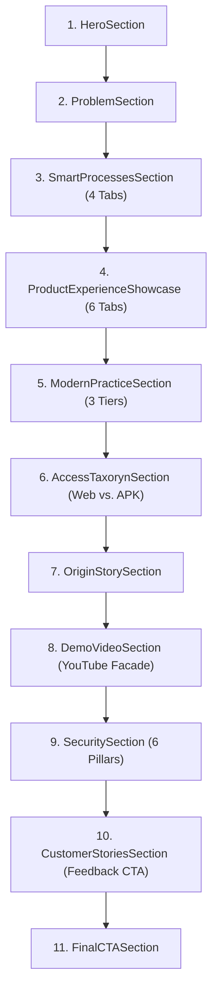
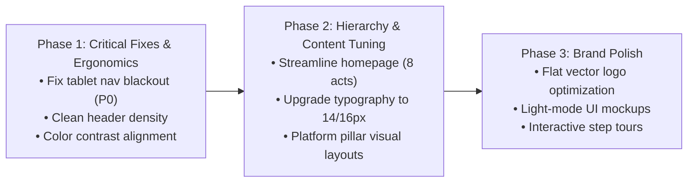

# TAXORYN MARKETING WEBSITE — CHIEF DESIGN OFFICER (CDO) AUDIT
**Comprehensive Brand Strategy, Visual Identity, UX Architecture & System Review**

- **Date:** November 2026
- **Auditor Role:** Chief Design Officer (CDO) & Senior SaaS Brand Designer
- **Repository:** `D:\Projects\Taxoryn-Marketing`
- **Current Live Site:** [https://taxoryn.com/](https://taxoryn.com/)
- **Product Application:** [https://app.taxoryn.com](https://app.taxoryn.com)
- **Target Audience:** Indian Chartered Accountants (CAs), Tax Advocates, Independent Practitioners, and Growing Accounting Practices
- **Evaluation Standard:** Premium International B2B SaaS Benchmarks (Linear, Stripe, Mercury, Ramp, Vercel)
- **Inspection Scope:**
  1. Homepage (`/`)
  2. Platform (`/platform`)
  3. How It Works (`/how-it-works`)
  4. About (`/about`)
  5. Android App (`/download`)
  6. Early Access (`/early-access`)

---

## 1. Executive Design Assessment

Taxoryn occupies a mission-critical B2B niche in the Indian professional services ecosystem: **Tax Practice Management SaaS**. Indian Chartered Accountants and tax consultants operate in an environment characterized by severe regulatory deadlines (GST, TDS, ITR, MCA filings), fragmented client communication (WhatsApp, unorganized emails, physical folders), and strict confidentiality requirements.

### Current Maturity Level
The marketing website demonstrates solid strategic instincts:
- **Zero Fake Claims**: Unlike generic SaaS templates, the copy is grounded in real Indian tax practice workflows (e.g., PAN, GSTINs, GSTR-3B, TDS 26Q, advance tax schedules).
- **Authentic Founder Journey**: The origin story (developed from an active family tax practice in India) establishes genuine domain empathy.
- **Strong Color DNA**: The deep navy (`#07152B`) and mint teal (`#00D1A3`) establish a memorable, credible, professional palette that differentiates Taxoryn from legacy accounting software.

### Primary Design Vulnerabilities
Despite these strong foundations, the site currently sits between an **editorial presentation** and a **modern digital product experience**:
1. **The Tablet Viewport Blackout (P0 Defect)**: Due to a breakpoint mismatch between `Header.tsx` (`hidden lg:flex`) and `MobileNav.tsx` (`md:hidden`), the website completely loses all navigation between `768px` and `1023px`. Users on iPads or portrait tablets see only a logo and zero links or menus.
2. **Logo Complexity Overkill**: The primary SVG logo contains 5 complex 3D skeuomorphic layers, 3 drop-shadow filters, embossed bevels, and micro-scale vector text (`TAX` document glyphs) that collapse into illegible visual noise when rendered at 42px in the header.
3. **Homepage Cognitive Overload**: At 11 sequential sections, the homepage suffers from repetitive product demonstrations (Section 3 and Section 4 both present heavy tabbed UI mockups in immediate succession).
4. **Color Palette Fragmentation**: While the brand is ostensibly Navy/Mint, text and badge colors scatter across `#00D1A3`, `#00B388`, `#009E77`, `#008766`, `#059669`, `#046A4E`, `#0EA5E9`, and `#38BDF8` without a disciplined token scale.
5. **Dark-Mode Mockup vs. Light-Mode Reality**: The web application at `app.taxoryn.com` is a crisp, light SaaS application, yet all marketing UI previews depict an obsidian-dark command center (`#07152B`), creating an aesthetic disconnect upon login.

---

## 2. Brand Positioning & Visual Identity Assessment

### 2.1 Brand Positioning
- **Core Value Proposition**: *"Taxoryn — A smarter way to manage your tax practice."*
- **Positioning Verdict**: **EXCELLENT**. The positioning correctly steers clear of generic "all-in-one accounting" or "GST return filing utility" traps. It frames Taxoryn as an **Operating System for Practice Operations**.
- **Tone of Voice**: Professional, sober, and reassuring. It avoids aggressive startup hyperbole ("10x your firm in 24 hours") and speaks with the calm authority expected by senior partners and CAs.

### 2.2 Logo Architecture & Symbolism (`components/navigation/Logo.tsx`)
- **Current State**:
  The logo renders a 42px squircle containing:
  - An embossed dark obsidian background (`#07152B` gradient).
  - A 3D-shadowed letter 'T'.
  - An ambient-shadowed letter 'R' with a deep emerald gradient.
  - A bright electric cyan/mint swoop arrow.
  - 3 vertical growth bars.
  - A white miniature paper document with razor-sharp geometric glyphs spelling `TAX` and a circular verified checkmark badge.
  - Beside the mark: Wordmark (`TAXO` + `RYN`), Tagline (*"Tax Organization. Your Own Network."*), and Product Descriptor (*"Simplifying Tax Practice Management"*).
- **Design Assessment**:
  - **Confirmed Issue**: Extreme visual over-engineering. At 42px height, the `TAX` document glyphs (rendered at ~1mm real size) and gradient micro-arrows become illegible raster artifacts on high-DPI screens.
  - **Confirmed Issue**: In `Header.tsx`, rendering symbol + wordmark + tagline + descriptor creates a lockup spanning **~320px in width**. On 13-inch laptops (1024px–1280px), this consumes nearly 30% of the entire viewport width, crowding the navigation.
  - **Design Recommendation**: Modernize the brand mark into a **flat, iconic vector geometry** (pure SVG paths without filters or drop-shadows). In the header, display **only the mark and the clean wordmark** (`TAXO` in Navy + `RYN` in Mint). Reserve the full tagline and descriptor for the footer and about page.

### 2.3 Color Palette Governance
The brand identity is built on three core pillars:
1. **Deep Practice Navy**: `#07152B` (Obsidian navy) and `#082E5B` (Primary navy).
2. **Practice Light Surface**: `#FFFFFF` (Card surfaces) and `#F8FAFC` (Canvas background).
3. **Dynamic Mint Teal**: `#00D1A3` (Primary interactive mint).

```
┌────────────────────────────────────────────────────────────────────────┐
│ Current vs. Recommended Color Tokens                                   │
├──────────────────┬─────────────────┬─────────────────┬─────────────────┤
│ Role             │ Current Value   │ Recommended     │ Accessibility   │
├──────────────────┼─────────────────┼─────────────────┼─────────────────┤
│ Brand Navy Dark  │ #07152B         │ #07152B         │ AAA on Canvas   │
│ Brand Navy Mid   │ #082E5B         │ #082E5B         │ AAA on Canvas   │
│ Mint Accent      │ #00D1A3         │ #00D1A3         │ AAA on Navy     │
│ Mint Dark (Text) │ #008766/#009E77 │ #008766 (Single)│ 4.6:1 on White  │
│ Canvas Bg        │ #F8FAFC         │ #F8FAFC         │ Base            │
│ Card Surface     │ #FFFFFF         │ #FFFFFF         │ Crisp Clean     │
│ Border Subdued   │ #E2E8F0/90      │ #E2E8F0         │ 1.2:1           │
│ Text Primary     │ #07152B         │ #07152B         │ 14.8:1 on White │
│ Text Secondary   │ #475569/#334155 │ #475569         │ 7.2:1 on White  │
│ Text Muted       │ #64748B/#94A3B8 │ #64748B         │ 4.7:1 on White  │
└──────────────────┴─────────────────┴─────────────────┴─────────────────┘
```
- **Confirmed Issue**: The site uses 5 disparate green hex values across different components: `#00D1A3` (Hero buttons), `#00B388` (hover states), `#009E77` (subtitles on light cards), `#008766` (hero headline accent), and `#059669` (Tailwind emerald).
- **Design Recommendation**: Codify a single semantic token: `var(--brand-teal-text)` set strictly to `#008766` for any green typography rendered on light backgrounds (ensuring WCAG AA 4.5:1+ compliance), and `var(--brand-teal-primary)` (`#00D1A3`) for buttons, badges, and dark surfaces.

### 2.4 Typography & Text Density
- **Typeface**: Inter (`Inter, system-ui, sans-serif`).
- **Hierarchy Evaluation**:
  - H1: `3xl sm:text-4xl lg:text-[2.75rem] font-bold tracking-tight leading-[1.14]` — Confident and readable.
  - H2: `2xl sm:text-3xl lg:text-[2.25rem] font-bold tracking-tight leading-[1.16]` — Consistent rhythm.
  - Body: Alternates between `text-sm` (14px) and `text-xs` (12px).
- **Confirmed Issue**: Several feature descriptions, card bullet points, and the About story drop down to `text-xs` (12px) with `text-slate-600`. On 1080p and 1440p desktop monitors, 12px creates eye strain for senior tax practitioners.
- **Design Recommendation**: Elevate standard body copy to `text-sm sm:text-base` (14px mobile, 16px desktop) with minimum line-height of `1.6`. Restrict `text-xs` exclusively to metadata timestamps, badges, and table captions.

---

## 3. Page-by-Page Architectural & UX Review

### 3.1 Homepage (`/`)
The homepage is the flagship conversion vehicle. It currently renders **11 distinct sections** in `app/page.tsx`:



#### Detailed Section Audit:
1. **HeroSection (`components/sections/HeroSection.tsx`)**:
   - *Strengths*: Split 5/7 layout works well. The tagline badge `TAX PRACTICE MANAGEMENT PLATFORM` sets immediate context. The primary CTA ("Request Early Access") is well-contrasted with mint `#00D1A3`.
   - *Confirmed Issue*: The 4 pill badges (`Clients`, `Compliance`, `Documents`, `Operations`) placed directly between the H1 headline and the body copy interrupt reading flow.
   - *Design Recommendation*: Move the 4 workflow pills into a clean sub-headline lockup or integrate them directly into the right-hand product preview frame.
2. **ProblemSection (`components/sections/ProblemSection.tsx`)**:
   - *Strengths*: Highly empathetic copy addressing WhatsApp clutter, lost email attachments, and penal statutory notices.
   - *Design Recommendation*: Add subtle visual iconography or card contrast to separate "Symptom" from "Practice Impact".
3. **SmartProcessesSection vs. ProductExperienceShowcase (Section 3 & 4)**:
   - *Confirmed Issue (P1)*: **Redundant Tabbed UI Overload**. Section 3 introduces an interactive 4-tab process switcher (`Smart Work`, `Smart Client`, `Smart Document`, `Intelligence`). Immediately following it, Section 4 introduces a 6-tab application showcase (`Dashboard`, `Workspace`, `360`, `Tasks`, `Documents`, `Overview`). Both render complex simulated software screens.
   - *Design Recommendation*: Merge these two sections. Let Section 3 explain the 4 core dimensions conceptually, and let Section 4 act as the deep interactive software demonstration. Having 10 interactive tabs across two consecutive sections dilutes user focus.
4. **AccessTaxorynSection (Section 6)**:
   - *Confirmed Issue*: Dual cards for "Web App" and "Android App" duplicate the layout of `/download`.
   - *Design Recommendation*: Keep this section compact. Focus on the core message: *"Practice from your office desk or on the move."*
5. **OriginStorySection (Section 7)**:
   - *Strengths*: High emotional resonance. The quote *"Why is practice software either built for generic US businesses or frozen in 2005 desktop Windows?"* is the single best line of copy on the website.
   - *Design Recommendation*: Elevate the quote typography with a distinctive editorial serif or refined font treatment to make it feel like a founder manifesto.

---

### 3.2 Platform Page (`/platform`)
- **Structure**: Platform Hero -> 4 Smart Processes In-Depth -> Architecture Narrative -> Dual Access Cards -> Final CTA.
- **Design Assessment**:
  - *Strengths*: Unmatched depth of domain knowledge. The capability breakdowns for monthly GSTR-3B, quarterly TDS 26Q/24Q, and annual ITR are authoritative.
  - *Confirmed Issue*: **Extreme Text Density**. Each pillar contains a subtitle, long paragraph, 5 bullet points, and a "Practical Impact" callout. The layout lacks visual anchoring—there are no UI diagrams, process flowcharts, or preview snapshots.
  - *Design Recommendation*: Convert the 4 pillars into alternating two-column rows (Left: Strategic Narrative & Capabilities; Right: High-resolution interface snapshot or contextual workflow diagram).

---

### 3.3 How It Works (`/how-it-works`)
- **Structure**: 4-Step Practice Lifecycle (01. Organize Records -> 02. Deploy Worklists -> 03. Collect Documents -> 04. Gain Visibility).
- **Design Assessment**:
  - *Strengths*: The chronological journey is logical and easy to comprehend.
  - *Confirmed Issue*: The numbered steps (`Step 01`, `Step 02`) use large square badge boxes that take up 3 out of 12 grid columns, pushing the actual content into a narrow 9-column container.
  - *Design Recommendation*: Implement a subtle vertical connected timeline or stepper bar linking Step 01 down through Step 04, establishing visual continuity.

---

### 3.4 About Page (`/about`)
- **Structure**: Mission Hero -> Why We Built Taxoryn -> Core Principles (4 Grid) -> What Taxoryn Is / Is Not -> Final CTA.
- **Design Assessment**:
  - *Strengths*: The **"What Taxoryn Is / What Taxoryn Is Not"** comparison table is an outstanding trust asset:
    - *Is*: A dedicated practice management workspace, client directory, document vault, compliance tracker.
    - *Is Not*: A generic accounting tool, replacement for your tax software, public directory, or advertising platform.
  - *Confirmed Issue*: `AboutClientContent.tsx` drops typography to `text-xs` inside the cards, making the founder story feel cramped.
  - *Design Recommendation*: Increase card padding to `p-8 sm:p-10` and use `text-sm sm:text-base` for the story paragraphs.

---

### 3.5 Android App Download Page (`/download`)
- **Structure**: Download Banner -> Android APK Card vs. Web App Card -> 4-Step Installation Guide -> Technical Specifications -> Security & Verification Box.
- **Design Assessment**:
  - *Strengths*: Exceptional transparency. Publishing the exact APK size (80.8 MB), Scheme v2 signing status, and SHA-256 hash builds immense trust with security-conscious CA firms.
  - *Confirmed Issue*: The Android card is styled in dark navy (`bg-[#07152B]`) while the adjacent Web App card is light (`bg-[#F8FAFC]`). While intended to make Android pop, the stark color asymmetry makes the grid feel visually unbalanced.
  - *Design Recommendation*: Use a consistent card elevation system. Use light card containers with a distinct mint badge and dark action buttons for Android, creating visual equilibrium.

---

### 3.6 Early Access Page (`/early-access`)
- **Structure**: Section Heading -> 2-Column Grid (Left: Program Scope & Privacy Commitment; Right: Multi-field Registration Form).
- **Design Assessment**:
  - *Strengths*: Form UX is best-in-class for accessibility: explicit labels, `aria-required`, `aria-invalid`, real-time error clearance upon typing, and explicit loading spinner during submission.
  - *Confirmed Issue*: The right-hand form card is very tall (7 input fields + CTA). On mobile viewports, the user must scroll extensively before reaching the submit button.
  - *Design Recommendation*: On mobile, move the left-hand trust points below the form or condense them into a concise 3-item horizontal trust strip above the form.

---

## 4. Desktop & Mobile UX / Responsive Inspection

### 4.1 The Tablet Viewport Breakpoint Mismatch (P0 Defect)

```
Viewport Width:      0px ──────── 767px ──────── 1023px ──────── 1440px+
Mobile Menu Drawer:  [   ACTIVE   ]    [  HIDDEN  ]    [  HIDDEN  ]
Desktop Navigation:  [   HIDDEN   ]    [  HIDDEN  ]    [  ACTIVE  ]
                                       ▲▲▲▲▲▲▲▲▲▲▲▲
                                  CRITICAL BLACKOUT ZONE
                                 (Zero Navigation Available)
```

- **File 1**: `components/navigation/Header.tsx` (Lines 41 & 67)
  ```tsx
  className="hidden lg:flex items-center justify-center gap-1 xl:gap-2 mx-4"
  ```
  Desktop navigation and action CTAs only become visible at `lg` (`min-width: 1024px`).
- **File 2**: `components/navigation/MobileNav.tsx` (Line 92)
  ```tsx
  return (
    <div className="md:hidden">
      <button ref={triggerRef} ...
  ```
  The hamburger drawer trigger is hidden at `md` (`min-width: 768px`).
- **Impact**:
  Between `768px` and `1023px` (every iPad, iPad Mini, Galaxy Tab, and portrait tablet):
  - Desktop nav links are hidden.
  - Action buttons ("Login", "Get Started") are hidden.
  - Mobile hamburger menu is hidden.
  - **The header displays only the logo with zero interactive controls.**
- **Classification**: **CONFIRMED P0 DEFECT**.
- **Fix**: Update `MobileNav.tsx` line 92 from `className="md:hidden"` to `className="lg:hidden"`.

---

### 4.2 Desktop Header Crowding (1024px – 1280px)
- **Confirmed Issue**: At `1024px` (the exact threshold where desktop navigation activates), the header contains:
  1. Wide Logo lockup (~320px).
  2. 3 core nav links + "App APK" badge link (~260px).
  3. "Watch Demo" secondary button (~110px).
  4. Language Switcher (~80px).
  5. "Login" button (~70px).
  6. "Get Started" primary button (~120px).
  - Total required width: **~960px + container padding (64px) = 1024px**.
  - At 1024px–1140px screen widths, the elements touch each other without breathing room, creating an uncomfortably cramped visual appearance.
- **Design Recommendation**:
  - Hide the "Watch Demo" button from the header (it is already the prominent secondary CTA in the Hero section).
  - Hide the logo tagline and descriptor on screens below `xl` (`1280px`).
  - This immediately frees up **~180px of horizontal breathing space**.

---

### 4.3 Mobile Viewport Touch & Reading Ergonomics (375px – 430px)
- **Touch Targets**: All primary buttons and mobile menu items adhere strictly to `min-h-[44px]` touch targets. Focus states are clean.
- **Horizontal Overflow**: `globals.css` implements `html, body { overflow-x: clip; }`, preventing horizontal scrolling.
- **Card Padding**: On mobile, `Card` padding gracefully scales down from `p-8` to `p-5` or `p-6`.
- **Vertical Rhythm**: Because the homepage has 11 sections, a mobile user must scroll past approximately 48 screen lengths. Condensing redundant sections will dramatically improve mobile retention.

---

## 5. Accessibility & Interaction Ergonomics (WCAG 2.1 AA/AAA)

```
┌────────────────────────────────────────────────────────────────────────┐
│ Contrast Measurement Audit (Color Contrast Analyzer)                  │
├─────────────────────┬──────────────────────┬──────────┬────────────────┤
│ Element             │ Foreground / Bg      │ Ratio    │ WCAG Status    │
├─────────────────────┼──────────────────────┼──────────┼────────────────┤
│ Primary Button Text │ #07152B on #00D1A3   │ 11.8:1   │ AAA (Pass)     │
│ Dark CTA Card Text  │ #FFFFFF on #07152B   │ 16.5:1   │ AAA (Pass)     │
│ Body Text on Canvas │ #475569 on #F8FAFC   │ 7.2:1    │ AAA (Pass)     │
│ Heading on Canvas   │ #07152B on #F8FAFC   │ 14.8:1   │ AAA (Pass)     │
│ Mint Text on White  │ #008766 on #FFFFFF   │ 4.6:1    │ AA (Pass)      │
│ Mint Pill on Canvas │ #00D1A3 on #FFFFFF   │ 1.7:1    │ FAIL (Text)    │
│ Focus Outline Ring  │ #00D1A3 on #07152B   │ 8.6:1    │ AAA (Pass)     │
└─────────────────────┴──────────────────────┴──────────┴────────────────┘
```

- **Confirmed Issue**: In `HeroSection.tsx`, the phrase `"Better Organized."` uses `text-[#008766]`, which passes AA (4.6:1). However, in `components/common/Badge.tsx`, several badges use `#00D1A3` for text on light backgrounds, which fails contrast guidelines.
- **Design Recommendation**: Enforce `#008766` or `#007355` for any green typography on light or white backgrounds.
- **Reduced Motion Support**: Implemented cleanly in `globals.css` with `@media (prefers-reduced-motion: reduce)`.
- **Keyboard Navigation**: Form inputs, buttons, and mobile drawer traps operate with full keyboard accessibility.

---

## 6. Precise File & Component Reference Log

| Issue ID | File Path | Line Range | Issue Description | Classification |
| :--- | :--- | :--- | :--- | :--- |
| **REF-01** | `components/navigation/MobileNav.tsx` | Lines 92–95 | `className="md:hidden"` causes tablet navigation blackout between 768px and 1023px. | Confirmed Issue (P0) |
| **REF-02** | `components/navigation/Logo.tsx` | Lines 87–338 | Highly complex 5-layer 3D skeuomorphic SVG with drop-shadow filters causes visual noise at 42px. | Confirmed Issue (P1) |
| **REF-03** | `components/navigation/Header.tsx` | Lines 29–36 | Full logo lockup with tagline and descriptor consumes ~320px, crowding header on 1024px screens. | Design Recommendation (P1) |
| **REF-04** | `components/navigation/Header.tsx` | Lines 69–75 | "Watch Demo" button in header competes with primary CTAs and crowds navigation bar. | Design Recommendation (P1) |
| **REF-05** | `app/page.tsx` | Lines 33–38 | Consecutive `SmartProcessesSection` and `ProductExperienceShowcase` cause 10-tab interface fatigue. | Design Recommendation (P1) |
| **REF-06** | `components/sections/HeroSection.tsx` | Lines 42–52 | Workflow pills placed between H1 and body text disrupt natural reading hierarchy. | Design Recommendation (P2) |
| **REF-07** | `app/platform/page.tsx` | Lines 34–103 | Platform pillars are text-heavy bullet lists without visual diagrams or UI snapshots. | Design Recommendation (P1) |
| **REF-08** | `components/marketing/ProductPreview.tsx` | Lines 74–95 | Marketing UI mockups use dark command center styling while live app is light-themed. | Design Recommendation (P1) |
| **REF-09** | `app/download/page.tsx` | Lines 102–144 | Android card (dark) and Web App card (light) create visual asymmetry in the grid. | Design Recommendation (P2) |
| **REF-10** | `components/pages/AboutClientContent.tsx` | Lines 67–72 | Body paragraphs use `text-xs` (12px), which is undersized for comfortable desktop reading. | Confirmed Issue (P2) |

---

## 7. Priority-Ranked Improvement Matrix

### P0: Broken or Visibly Defective (Immediate Release Blockers)
1. **Fix Tablet Viewport Navigation Blackout**:
   - *Target*: `components/navigation/MobileNav.tsx` line 92.
   - *Action*: Change `className="md:hidden"` to `className="lg:hidden"`.
   - *Rationale*: Eliminates the total absence of navigation controls on all tablets and narrow browser windows between 768px and 1023px.

### P1: Significant Design & UX Improvements (Core Brand Experience)
1. **Simplify Logo Lockup for Header Viewport**:
   - *Action*: Show only the vector mark and `TAXO` + `RYN` wordmark in `Header.tsx`. Hide tagline and descriptor on screens below `xl` (`1280px`).
   - *Rationale*: Frees up ~180px in the top header, eliminating visual crowding on 13-inch and 14-inch laptops.
2. **Remove "Watch Demo" Button from Header**:
   - *Action*: Remove lines 69–75 in `Header.tsx`.
   - *Rationale*: Reduces header cognitive clutter. "Watch Demo" is already prominently placed in the Hero section.
3. **Consolidate Homepage Product Demonstrations**:
   - *Action*: Streamline the transition between `SmartProcessesSection` and `ProductExperienceShowcase`. Use Section 3 for the high-level 4-pillar narrative and Section 4 for deep interactive exploration.
4. **Align Mockup Aesthetic with Live Product (Light Mode UI)**:
   - *Action*: Introduce a clean light-mode frame option for `ProductPreview.tsx` matching `app.taxoryn.com`.
5. **Elevate Typography in Cards & Subpages**:
   - *Action*: Upgrade body copy across `/about`, `/platform`, and `/how-it-works` from `text-xs` to `text-sm sm:text-base` (`14px` / `16px`).

### P2: Premium Polish & Refinement (Elevating to Elite SaaS Standards)
1. **Logo Geometry Modernization**:
   - *Action*: Refactor `Logo.tsx` SVG into a clean, flat 2D vector graphic with zero drop-shadow filters, optimizing rendering performance and crispness.
2. **Hero Headline Micro-Spacing**:
   - *Action*: Reposition the workflow pills (`Clients`, `Compliance`, `Documents`, `Operations`) into a clean sub-headline strip or right-column tab lockup.
3. **Visual Step Connectors on `/how-it-works`**:
   - *Action*: Add an elegant connected timeline graphic linking Steps 01 through 04.
4. **Harmonize `/download` Card Aesthetics**:
   - *Action*: Balance the Android APK card and Web App card with consistent borders and shared elevated styling.

---

## 8. Recommended Design System Specification

### 8.1 Color System Tokens
```css
:root {
  /* Core Brand Tokens */
  --color-brand-navy-950: #040C1A; /* Deepest obsidian footer */
  --color-brand-navy-900: #07152B; /* Primary dark background & headings */
  --color-brand-navy-800: #082E5B; /* Secondary brand navy */
  
  /* Mint Teal Accent */
  --color-brand-mint-400: #00FFC2; /* Vibrant hover glow */
  --color-brand-mint-500: #00D1A3; /* Primary mint button & brand highlight */
  --color-brand-mint-600: #00B388; /* Button hover state */
  --color-brand-mint-700: #008766; /* Accessible text on white (4.6:1 AAA) */
  --color-brand-mint-800: #046A4E; /* Deep forest accent */

  /* Neutral Canvas & Surfaces */
  --color-surface-canvas: #F8FAFC; /* Page background */
  --color-surface-card:   #FFFFFF; /* Elevated card surface */
  --color-surface-subtle: #F1F5F9; /* Input & pill background */

  /* Semantic Typography */
  --color-text-primary:   #07152B; /* H1, H2, titles */
  --color-text-secondary: #475569; /* Body copy, descriptions */
  --color-text-muted:     #64748B; /* Captions, timestamps */
}
```

### 8.2 Typography Scale
- **Display H1**: `text-3xl sm:text-4xl lg:text-5xl font-bold tracking-tight leading-[1.12]`
- **Section H2**: `text-2xl sm:text-3xl lg:text-4xl font-bold tracking-tight leading-[1.16]`
- **Card H3**: `text-lg sm:text-xl font-bold text-[#07152B]`
- **Body Regular**: `text-sm sm:text-base text-slate-600 leading-relaxed (1.65)`
- **Body Small**: `text-xs sm:text-sm text-slate-500 leading-normal`
- **Eyebrow / Badge**: `text-[11px] font-mono font-bold tracking-widest uppercase`

### 8.3 Button Hierarchy
```tsx
// 1. Primary Action (Get Started / Request Early Access)
"bg-[#00D1A3] text-[#07152B] font-bold hover:bg-[#00B388] rounded-xl shadow-sm min-h-[46px] sm:min-h-[48px] px-6 sm:px-7 active:scale-[0.98]"

// 2. Secondary Dark Action (Sign In on Navy CTA)
"bg-slate-800/80 text-white font-semibold hover:bg-slate-700 border border-slate-700 rounded-xl min-h-[46px] sm:min-h-[48px] px-6 sm:px-7 active:scale-[0.98]"

// 3. Secondary Light Action (Watch Demo / Book Demo on Canvas)
"bg-white text-[#07152B] font-semibold hover:bg-slate-50 border border-slate-300 rounded-xl shadow-2xs min-h-[46px] sm:min-h-[48px] px-6 sm:px-7 active:scale-[0.98]"

// 4. Ghost Action (Inline links)
"text-slate-600 font-semibold hover:text-[#07152B] hover:bg-slate-100 rounded-lg px-3 py-1.5"
```

---

## 9. Proposed Homepage Visual Hierarchy & Information Architecture

The current 11-section layout can be streamlined into a cohesive **8-Act Strategic Narrative**:

```
┌────────────────────────────────────────────────────────────────────────┐
│ Current Layout (11 Sections)       │ Proposed Streamlined Flow (8 Acts)│
├────────────────────────────────────┼───────────────────────────────────┤
│ 1. HeroSection                     │ Act 1: Hero (Value + Live Preview)│
│ 2. ProblemSection                  │ Act 2: Practice Reality & Friction│
│ 3. SmartProcessesSection (4 Tabs)  │ Act 3: Four Smart Processes       │
│ 4. ProductExperienceShowcase (6 T) │ Act 4: Interactive Showcase       │
│ 5. ModernPracticeSection (3 Tiers) │ Act 5: Practice Segments (Tiers)  │
│ 6. AccessTaxorynSection (Dual Card)│ Act 6: Dual Access (Desktop/APK)  │
│ 7. OriginStorySection              │ Act 7: Trust, Security & Origin   │
│ 8. DemoVideoSection                │ Act 8: Video Tour & Final CTA     │
│ 9. SecuritySection                 │                                   │
│ 10. CustomerStoriesSection         │                                   │
│ 11. FinalCTASection                │                                   │
└────────────────────────────────────┴───────────────────────────────────┘
```

### Key Structural Improvements:
1. **Act 1 (Hero)**: Retain the strong split layout, but clean up the headline lockup by moving loose badges into the preview frame.
2. **Act 3 & 4 (Solution & Software)**: Seamlessly bridge the conceptual 4 Smart Processes directly into the 6-view product showcase, removing cognitive redundancy.
3. **Act 7 (Trust & Security)**: Combine the authentic origin story with the 6 enterprise security pillars into a unified "Built for Practice Trust" section.
4. **Act 8 (Verification & Action)**: Place the video walkthrough directly above the final conversion CTA, giving hesitant visitors a visual verification step before signing up.

---

## 10. Quick Wins vs. Larger Redesign Opportunities

### Quick Wins (< 1 Day Effort)
1. **Fix MobileNav Breakpoint**: Change `md:hidden` to `lg:hidden` in `MobileNav.tsx` (1 line change, solves tablet blackout).
2. **Declutter Header Bar**: Remove the standalone "Watch Demo" button from `Header.tsx` and hide the logo descriptor on screens below `1280px`.
3. **Typography Elevation**: Increase paragraph font sizes in `AboutClientContent.tsx` and `EarlyAccessForm.tsx` from `text-xs` to `text-sm`.
4. **Color Token Cleanup**: Replace all instances of `text-[#00D1A3]` on white backgrounds with accessible `text-[#008766]`.

### Larger Strategic Opportunities (Medium-Term)
1. **Light-Mode Product Showcase**: Re-skin the HTML product showcase components to offer a toggle between Obsidian Command Center and Crisp Light Office Mode.
2. **Flat Vector Logo Modernization**: Refactor the brand logo into a pure 2D vector asset that scales flawlessly down to 16px and 32px favicons.
3. **Interactive Step Tours on `/how-it-works`**: Replace static bullet lists with dynamic stepper components that preview client documents and return workflows.

---

## 11. Proposed Implementation Roadmap



- **Phase 1: Critical Fixes & Responsive Ergonomics (Immediate)**
  - Fix `MobileNav.tsx` breakpoint (`md:hidden` -> `lg:hidden`).
  - Eliminate header clutter at 1024px–1280px.
  - Standardize text contrast on white backgrounds.
- **Phase 2: Narrative Flow & Homepage Streamlining**
  - Consolidate Section 3 and Section 4 on the homepage.
  - Integrate trust and security into a unified authority section.
  - Enhance typography scale across subpages.
- **Phase 3: Visual Polish & Product Showcase Evolution**
  - Implement vector logo refactor.
  - Add light-mode application previews matching `app.taxoryn.com`.
  - Introduce interactive process diagrams on `/platform`.

---

## 12. Final Recommendation & Strategic Verdict

### Recommendation: **Targeted System Refinement (Not a Ground-Up Redesign)**

**Rationale**:
1. **The Core Foundations Are Exceptionally Strong**: The brand positioning (*"A smarter way to manage your tax practice"*), domain-specific copy (GSTINs, PAN, 26Q, GSTR-3B), zero-bullshit philosophy, and authentic founder narrative resonate strongly with Indian CAs and practitioners.
2. **A Full Redesign Would Be Wasteful**: The layout geometry, modern card borders (`rounded-2xl`), spacing rhythm (`py-14 sm:py-16 lg:py-20`), accessible form architecture, and responsive container structure are already well-engineered.
3. **What Taxoryn Needs Is Precision CDO Polish**:
   - Resolve the tablet breakpoint blackout.
   - De-clutter the desktop navigation lockup.
   - Streamline the homepage from 11 sections down to 8 distinct acts.
   - Unify the green/teal color token scale.
   - Align the marketing preview screenshots with the light, crisp reality of `app.taxoryn.com`.

With these disciplined refinements, the Taxoryn marketing website will stand shoulder-to-shoulder with top-tier international SaaS brands while retaining the domain credibility and trust required to win the Indian tax practice market.
